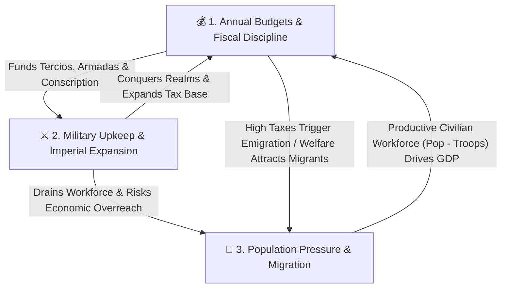

# Multi-Era Macroeconomic, Fiscal & Demographic Architecture

This skill defines the core economic simulation model and the progressive, era-gated financial instruments that govern empire building in **Kingdom Conquest**.

---

## 1. The Three Core Gameplay Conflicts

The grand strategy loop is driven by the tension between three interdependent pillars:

1. **Budgets & Fiscal Discipline**:
   - Players manage an **Annual Exchequer Budget** comparing **Last Year's Actual Expenditure & Revenue** against **This Year's Planned Allocations**.
   - Prudent budgeting protects currency stability, funds infrastructure/markets, and builds gold reserves that enable future military campaigns.
   - **Economic Overreach**: Expanding military commitments beyond fiscal capacity starves capital investment, triggers troop desertion, or forces confiscatory taxation.

2. **Military & Imperial Maintenance**:
   - Recruiting standing armies and border garrisons incurs **continuous annual upkeep** (`troops * troopUpkeep`) and removes citizens from the productive civilian workforce (`workforce = population - troops`).
   - Active warfare inflicts frontline attrition (~8% annually) and triggers **continuous conscription**, draining both gold reserves and civilian population.
   - **Diplomacy as a Strategic Shield**: Sending envoys and forging alliances requires upfront tribute/gifts but prevents ruinous multi-front wars.

3. **Population Pressure & Tax-Driven Migration**:
   - **Population Pressure (`0–100%`)**: Rises as population density approaches infrastructure capacity or when military mobilization strips the civilian economy. High pressure requires infrastructure expansion and social spending.
   - **Taxation Consequences (Laffer Curve & Migration)**:
     - Moderate taxes (`25%–58%`) fund the state sustainably.
     - Confiscatory taxes (`> 60%`) depress GDP output and trigger **Tax Flight (Emigration)**—citizens flee high-tax or war-torn realms and resettle in lower-tax, prosperous countries.
     - Low taxes (`<= 30%`) paired with social welfare and infrastructure attract **Immigration**, accelerating demographic and economic growth.

---

## 2. Layer-by-Layer Era Evolution Roadmap

The fiscal model begins as a disciplined hard-specie ledger in the early eras and unlocks progressively more sophisticated—and dangerous—sovereign finance mechanisms as history advances. Every layer is implemented incrementally with dedicated unit and integration tests.

| Layer | Historical Era(s) | Years | Fiscal Regime | Key Financial Instruments & Risks |
| :--- | :--- | :--- | :--- | :--- |
| **Layer 1** | `discovery` & `revolt` | 1500–1859 | **Balanced-Budget Specie Regime** | Hard gold specie; **Zero-Deficit Rule**; automatic discretionary rationing; tax-driven migration |
| **Layer 2** | `independence` | 1860–1919 | **World Bank Credit Facility** | Sovereign loans; controlled budget deficits; interest service; debt ceilings; default penalties |
| **Layer 3** | `decolonisation` | 1920–1988 | **Sovereign Bond Markets** | Short/long-term government bonds; dynamic yield curves; credit ratings; rollover & inflation risk |
| **Layer 4** | `modern` | 1989+ | **Securitized & Derivative Markets** | Derivatives, CDOs, CDSs, Inflation-Linked Securities (TIPS/Gilts); leverage multipliers; systemic contagion |

---

### Layer 1: Hard-Specie Balanced Budgets (1500–1859 — *Implemented*)

In the **Age of Discovery** and **Age of Revolt**, sovereign credit institutions do not yet exist. Kingdoms operate strictly on hard gold ducats and annual balanced budgets:

1. **Annual Budget Statement**:
   - Tracks **Last Year's Ledger** (`last_tax_revenue`, `last_market_income`, `last_military_exp`, `last_social_exp`, `last_investment_exp`, `last_total_exp`, `last_budget_balance`, `last_migration`).
   - Projects **This Year's Budget** from current tax rates, market tiers, standing troop counts, and investment/social allocations.
2. **Strict No-Deficit Enforcement (`EnforceBalancedBudget`)**:
   - Planned annual expenditure (`military_upkeep + social_spend + investment_spend`) **cannot exceed** annual revenue (`tax_revenue + market_revenue`).
   - Priority of payment:
     1. **Standing Military Upkeep** is paid first from available revenue.
     2. **Discretionary Outlays** (`investment` and `social_costs`) are proportionally rationed/capped to fit within remaining revenue (`total_revenue - military_upkeep`).
     3. If military upkeep alone exceeds total revenue and treasury reserves reach `0`, unpaid troops automatically demobilize/desert until military expenditure matches revenue.
   - Result: `budget_balance >= 0` and `resources >= 0` at all times during Layer 1.
3. **Demographic Migration**:
   - `ComputeMigration(population, taxRate, socialCosts, infrastructure)` calculates annual net migration:
     - `taxRate > 60%`: progressive emigration scaling quadratically with excess tax burden.
     - `taxRate <= 35%`: immigration bonus scaling with social welfare and infrastructure tiers.
     - Emigrants from high-tax realms partially redistribute to low-tax kingdoms in `TickEconomyStep`.

---

### Layer 2: The World Bank & Sovereign Loans (1860–1919 — *Planned Next*)

Entering the **Age of Independence** (`year >= 1860`), industrial warfare and railway/harbor expansion outgrow annual tax receipts. A global **World Bank** is established:

1. **Deficit Spending Unlocked**:
   - Governments may run an annual budget deficit if covered by an active **World Bank Credit Line** or **Sovereign Term Loan**.
2. **World Bank Mechanics**:
   - **Credit Limit**: `MaxBorrowingCapacity = 2.5 * AnnualGDP`.
   - **Interest Rate**: `LoanRate = BaseWorldBankRate (4.0%) + CountryRiskPremium`, where the risk premium rises with the country's `DebtToGDPRatio` and active war status.
   - **Mandatory Debt Service**: Annual interest + scheduled principal amortization is deducted as a **First-Lien Priority** before military upkeep or discretionary spending.
   - **Structural Adjustment / Default**: If a kingdom fails to service its World Bank loan, the World Bank freezes new credit, imposes an automatic tariff garnish on market revenues, and triggers severe domestic unrest.

---

### Layer 3: Sovereign Bond Markets (1920–1988 — *Planned*)

In the **Age of Decolonisation** (`year >= 1920`), states transition from bilateral World Bank loans to open **Sovereign Bond Markets**:

1. **Bond Issuance & Tranches**:
   - Governments can issue **2-Year Treasury Bills**, **5-Year Exchequer Notes**, and **10-Year Sovereign Bonds** to fund large-scale deficits.
2. **Market-Driven Yield Curves**:
   - Bond yields (`CouponRate`) float dynamically based on:
     - `DebtToGDP = TotalBondPrincipal / GDP`
     - `InflationRate` (investors demand positive real yields)
     - `CurrencyValue` stability
3. **Rollover & Bond Vigilante Risk**:
   - Maturing bonds must be repaid from the treasury or rolled over by issuing new bonds at prevailing market yields.
   - Excessive deficit spending spikes yields ("Bond Vigilantes"), crowding out military and social budgets.

---

### Layer 4: Modern Financial Instruments & Systemic Risk (1989+ — *Planned*)

In **The Modern Age** (`year >= 1989`), globalized capital markets introduce high-powered financial engineering and systemic tail risks:

1. **Inflation-Linked Securities (TIPS / Index-Linked Gilts)**:
   - Sovereign bonds whose principal and coupon payments automatically index to `InflationRate`.
   - Protects bondholders and lowers initial borrowing costs during low inflation, but causes explosive fiscal debt-service spirals if wartime deficits or loose monetary policy trigger inflation spikes.
2. **Collateralized Debt Obligations (CDOs)**:
   - Pools of sovereign and commercial trade obligations packaged into Senior, Mezzanine, and Equity tranches.
   - Boosts domestic `MarketRevenue` and `Investment` multipliers during economic expansions, but suffers correlated tranche wipeouts if any underlying trading partner defaults or enters recession.
3. **Credit Default Swaps (CDSs)**:
   - Insurance contracts written on sovereign debt default risk.
   - Players can buy CDS protection to hedge against rival empires' defaults—or speculate via "naked CDS" positions—while sellers collect annual premium income but face catastrophic margin calls if a sovereign default occurs.
4. **Derivatives & Systemic Contagion**:
   - Interest-rate swaps and currency forwards amplify treasury returns up to a leverage factor $L \in [1, 5]$, but introduce **Mark-to-Market Margin Calls** and cross-border financial contagion when market volatility (`MarketRisk`) swings negative.

---

## 3. Testing & Verification Protocol

Every macroeconomic layer must maintain 100% pass rates across `go test ./...` before advancing to the next layer:

1. **Layer 1 Invariants (Current)**:
   - `TestBalancedBudgetNoDeficit`: Verifies that when desired expenditure exceeds revenue, `EnforceBalancedBudget` caps discretionary outlays and ensures `BudgetBalance >= 0`.
   - `TestTaxDrivenMigration`: Verifies that punitive tax rates (`> 60%`) cause negative net migration (emigration), while low tax rates (`<= 30%`) with infrastructure attract positive immigration.
   - `TestPopulationPressure`: Verifies that high population density without infrastructure or excessive military mobilization raises `PopulationPressure`.
   - `TestLastYearExpenditureTracking`: Verifies that annual simulation ticks persist Last Year's actual revenue, expenditure breakdown, and migration for display in the player's Budget Ledger.
