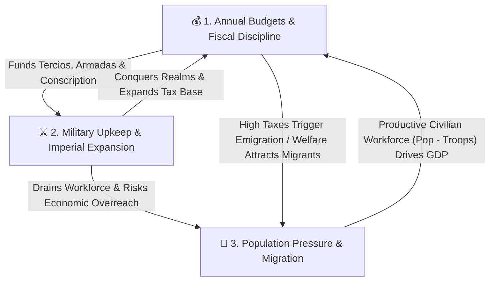
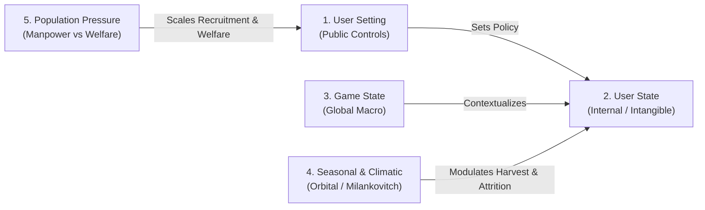

# Multi-Era Macroeconomic, Fiscal & Demographic Architecture

This skill defines the core economic simulation model and the progressive, era-gated financial instruments that govern empire building in **Kingdom Conquest**.

---

## 1. The Three Core Gameplay Conflicts

The grand strategy loop is driven by the tension between three interdependent pillars:

1. **Budgets & Fiscal Discipline**:
   - Players manage an **Annual Exchequer Budget** comparing **Last Year's Actual Expenditure & Revenue** against **This Year's Planned Allocations**.
   - Prudent budgeting protects currency stability, funds infrastructure/markets, and builds gold reserves that enable future military campaigns.
   - **Economic Overreach**: Expanding military commitments beyond fiscal capacity starves capital investment, triggers troop desertion, or forces confiscatory taxation.

2. **Military & Imperial Maintenance**:
   - Recruiting standing armies and border garrisons incurs **continuous annual upkeep** (`troops * troopUpkeep`) and removes citizens from the productive civilian workforce (`workforce = population - troops`).
   - Active warfare inflicts frontline attrition (~8% annually) and triggers **continuous conscription**, draining both gold reserves and civilian population.
   - **Diplomacy as a Strategic Shield**: Sending envoys and forging alliances requires upfront tribute/gifts but prevents ruinous multi-front wars.

3. **Population Pressure, Wealth Factor & Segmented Migration**:
   - **Population Pressure (`0–100%`)**: Rises as population density approaches infrastructure capacity or when military mobilization strips the civilian economy. High pressure requires infrastructure expansion and social spending.
   - **Variable Wealth Factor ($W \in [0.0, 1.0]$) & Wealthy Percentage ($P_{\text{wealthy}} \in [2\%, 18\%]$)**:
     - The population is segmented into the **Wealthy Merchant Class** and the **General Settler Populace**.
     - $P_{\text{wealthy}} = 0.02 + W \times 0.16$, where $W$ is driven by GDP per capita, commercial markets tier, infrastructure level, treasury gold solvency, and merchant entrepreneurial pride.
   - **Empirical Taxation Thresholds**:
     1. **Capital Haven (`taxRate <= 20%`)**: Attracts foreign capital and wealthy merchant relocations (`wealthy_migration > 0`), injecting fresh gold specie into the national treasury (`+5 gold/wealthy immigrant`).
     2. **Fair Prosperity (`21% <= taxRate <= 35%`)**: Civic sweet spot. Encourages steady family, artisan, and settler immigration (`general_migration > 0`). Wealthy remain content with zero flight.
     3. **Moderate / Normal (`36% <= taxRate <= 58%`)**: Standard tax burden. Migration is neutral, stimulated primarily by cathedral/guild social spending (`social_costs`) and infrastructure.
     4. **Heavy Drag (`59% <= taxRate <= 68%`)**: Burdensome taxes blunt natural demographic growth and cause marginal merchants and settlers to seek opportunities abroad.
     5. **Extreme Wealth Flight (`taxRate > 68%`)**: Confiscatory taxation! The wealthy migrate away first and fastest (`wealthy_migration < 0`), triggering **Capital Flight** that drains treasury specie reserves (`-10 gold/fleeing wealthy citizen`) and degrades entrepreneurial pride. General citizens also emigrate at an accelerated rate.

---

## 2. Layer-by-Layer Era Evolution Roadmap

The fiscal model begins as a disciplined hard-specie ledger in the early eras and unlocks progressively more sophisticated—and dangerous—sovereign finance mechanisms as history advances. Every layer is implemented incrementally with dedicated unit and integration tests.

| Layer | Historical Era(s) | Years | Fiscal Regime | Key Financial Instruments & Risks |
| :--- | :--- | :--- | :--- | :--- |
| **Layer 1** | `discovery` & `revolt` | 1500–1859 | **Balanced-Budget Specie Regime** | Hard gold specie; **Zero-Deficit Rule**; automatic discretionary rationing; tax-driven migration |
| **Layer 2** | `independence` | 1860–1919 | **World Bank Credit Facility** | Sovereign loans; controlled budget deficits; interest service; debt ceilings; default penalties |
| **Layer 3** | `decolonisation` | 1920–1988 | **Sovereign Bond Markets** | Short/long-term government bonds; dynamic yield curves; credit ratings; rollover & inflation risk |
| **Layer 4** | `modern` | 1989+ | **Securitized & Derivative Markets** | Derivatives, CDOs, CDSs, Inflation-Linked Securities (TIPS/Gilts); leverage multipliers; systemic contagion |

---

### Layer 1: Hard-Specie Balanced Budgets & Historical Fiscal Archetypes (1500–1859 — *Implemented*)

In the **Age of Discovery** and **Age of Revolt**, sovereign credit institutions do not yet exist. Kingdoms operate strictly on hard gold ducats and annual balanced budgets.

Crucially, **income tax did not exist** (first invented in Britain in 1799). Government revenue was derived from **customs tariffs (*Tonnage & Poundage*), the royal domain, monopolies/privateering, and feudal land taxes**. Furthermore, different kingdoms had vastly different fiscal architectures and constraints:

#### Country-Specific Fiscal Archetypes & Variances Matrix

| Realm Code | Realm Name | Fiscal Archetype | Agrarian Tax Mod (`tax_mod`) | Maritime Trade Mod (`trade_mod`) | Strategic Dilemma & Revenue Source |
| :--- | :--- | :--- | :--- | :--- | :--- |
| **`ENG`** | Kingdom of England | `maritime` | **0.50** | **1.80** | **Customs & Shipping:** Parliamentary limits on land taxes; relies heavily on port customs (*Tonnage & Poundage*), wool duties, and overseas caravel expeditions. |
| **`ESP`** | Crown of Spain | `bullion_monopoly` | **0.85** | **1.40** | **Silver Monopoly & Overstretch:** *Alcabala* sales tax and *Quinto Real* (Royal Fifth); massive silver influx offset by heavy garrison maintenance abroad (*Tercios* in Flanders/Italy). |
| **`POR`** | Kingdom of Portugal | `maritime` | **0.55** | **1.75** | **Spice Route Pioneer:** Small home population, reliant on Cape Route trade posts (*Feitorias*) and naval spice monopolies. |
| **`FRA`** | Kingdom of France | `agrarian_bureaucracy` | **1.30** | **0.65** | **Agrarian Leviathan:** Massive peasant population subject to the direct *Taille* and salt *Gabelle*; high continental manpower but slow early oceanic shipping. |
| **`VEN`** | Republic of Venice | `merchant_republic` | **0.15** | **2.50** | **Plutocratic Maritime Empire:** Negligible agrarian base; 90%+ income is spice/silk transit tariffs and salt monopolies (*Stato da Màr*). High per-capita wealth, vulnerable to Ottoman naval wars. |
| **`GEN`** | Republic of Genoa | `merchant_republic` | **0.20** | **2.30** | **Merchant Bankers:** Maritime trade and sovereign banking hub; low land tax, high commercial tariff multiplier. |
| **`NED`** | Dutch Republic | `maritime` | **0.45** | **2.00** | **Commercial Entrepot:** Advanced capital markets, flute shipping, and chartered VOC monopolies; supreme trade velocity. |
| **`POL`** | Poland-Lithuania | `noble_commonwealth` | **0.40** | **1.10** | **Szlachta Immunity:** Rich Baltic grain exporter via Danzig, but noble tax exemptions under *Nihil Novi* starve the Royal Treasury of cash. |
| **`OTT`** | Ottoman Empire | `imperial_fief` | **1.10** | **1.20** | **Imperial Crossroads & Fiefs:** Non-Muslim poll taxes (*Jizya/Cizye*) and *Kharaj* land tribute; military maintained via *Timar* land grants rather than cash payroll. |
| **`RUS`** | Tsardom of Muscovy | `agrarian_bureaucracy` | **1.20** | **0.60** | **Autocratic Land Extraction:** High serf extraction and fur tribute (*Yassak*); landlocked with minimal maritime tariffs. |
| **`HRE`** | Holy Roman Empire | `agrarian_bureaucracy` | **0.90** | **0.90** | **Fragmented Imperial Diet:** Fragmented estates and tolls; moderate balanced baseline. |
| **`SCO`** | Kingdom of Scotland | `noble_commonwealth` | **0.50** | **1.00** | **Clan Autonomy:** Low central crown extraction; relies on modest port trade. |
| **`DEN`** | Kingdom of Denmark | `maritime` | **0.60** | **1.50** | **Sound Toll Gatekeeper:** Controls Baltic entry tariffs (*Øresundstolden*). |
| **`SWE`** | Kingdom of Sweden | `balanced` | **0.80** | **1.20** | **Baltic Copper & Iron:** Falu copper mine royalties and Baltic coastal trade. |

#### Calibrated Macroeconomic Specie Scale (1500 Discovery Era)
1. **Agrarian Land Extraction Baseline:**
   - Calibrated at `baseProductivity = 0.0002` gold output per capita.
   - For England (pop 4,500,000), a standard 50% extraction effort yields `4,500,000 * 0.0002 * 0.50 * 0.50 (tax_mod) = ~225 gold/cycle`.
   - Peasant tithes in 1500 were mostly in kind (grain, livestock) and did not automatically convert into spendable gold specie in royal vaults.
2. **Maritime Trade as the Crown's Essential Lifeblood:**
   - To make building shipping an indispensable strategic imperative, maritime trade yields must be lucrative relative to ship construction capex.
   - Each completed expedition fleet grants $+5\%$ compounded yield, generating:
     $$\text{Trade Revenue} = (\text{colonialYield} \times 1500.0 + \text{markets} \times 12) \times \text{ProductivityFactor} \times (1.0 + \text{colonialYield}) \times \text{CommercialVelocity} \times \text{trade\_mod}$$
   - For England (`trade_mod = 1.80`), a single completed caravel fleet earns **$\approx 135\text{ gold/year}$** in recurring customs and tariffs on a $360\text{ G/year}$ capex investment (a **19%–25% annual return on invested capital**).
   - 3 active fleets generate **$400+\text{ gold/year}$**, exceeding the entire agrarian land tax take, mirroring Elizabethan reliance on maritime privateering, customs (*Tonnage & Poundage*), and chartered shipping!

1. **Annual Budget Statement**:
   - Tracks **Last Year's Ledger** (`last_tax_revenue`, `last_market_income`, `last_military_exp`, `last_social_exp`, `last_investment_exp`, `last_total_exp`, `last_budget_balance`, `last_migration`).
   - Projects **This Year's Budget** from current tax rates, market tiers, standing troop counts, and investment/social allocations.
2. **Strict No-Deficit Enforcement (`EnforceBalancedBudget`)**:
   - Planned annual expenditure (`military_upkeep + social_spend + investment_spend`) **cannot exceed** annual revenue (`tax_revenue + market_revenue`).
   - Priority of payment:
     1. **Standing Military Upkeep** is paid first from available revenue.
     2. **Discretionary Outlays** (`investment` and `social_costs`) are proportionally rationed/capped to fit within remaining revenue (`total_revenue - military_upkeep`).
     3. If military upkeep alone exceeds total revenue and treasury reserves reach `0`, unpaid troops automatically demobilize/desert until military expenditure matches revenue.
   - Result: `budget_balance >= 0` and `resources >= 0` at all times during Layer 1.
3. **Demographic Migration**:
   - `ComputeMigration(population, taxRate, socialCosts, infrastructure)` calculates annual net migration:
     - `taxRate > 60%`: progressive emigration scaling quadratically with excess tax burden.
     - `taxRate <= 35%`: immigration bonus scaling with social welfare and infrastructure tiers.
     - Emigrants from high-tax realms partially redistribute to low-tax kingdoms in `TickEconomyStep`.

---

### Layer 2: The World Bank & Sovereign Loans (1860–1919 — *Planned Next*)

Entering the **Age of Independence** (`year >= 1860`), industrial warfare and railway/harbor expansion outgrow annual tax receipts. A global **World Bank** is established:

1. **Deficit Spending Unlocked**:
   - Governments may run an annual budget deficit if covered by an active **World Bank Credit Line** or **Sovereign Term Loan**.
2. **World Bank Mechanics**:
   - **Credit Limit**: `MaxBorrowingCapacity = 2.5 * AnnualGDP`.
   - **Interest Rate**: `LoanRate = BaseWorldBankRate (4.0%) + CountryRiskPremium`, where the risk premium rises with the country's `DebtToGDPRatio` and active war status.
   - **Mandatory Debt Service**: Annual interest + scheduled principal amortization is deducted as a **First-Lien Priority** before military upkeep or discretionary spending.
   - **Structural Adjustment / Default**: If a kingdom fails to service its World Bank loan, the World Bank freezes new credit, imposes an automatic tariff garnish on market revenues, and triggers severe domestic unrest.

---

### Layer 3: Sovereign Bond Markets (1920–1988 — *Planned*)

In the **Age of Decolonisation** (`year >= 1920`), states transition from bilateral World Bank loans to open **Sovereign Bond Markets**:

1. **Bond Issuance & Tranches**:
   - Governments can issue **2-Year Treasury Bills**, **5-Year Exchequer Notes**, and **10-Year Sovereign Bonds** to fund large-scale deficits.
2. **Market-Driven Yield Curves**:
   - Bond yields (`CouponRate`) float dynamically based on:
     - `DebtToGDP = TotalBondPrincipal / GDP`
     - `InflationRate` (investors demand positive real yields)
     - `CurrencyValue` stability
3. **Rollover & Bond Vigilante Risk**:
   - Maturing bonds must be repaid from the treasury or rolled over by issuing new bonds at prevailing market yields.
   - Excessive deficit spending spikes yields ("Bond Vigilantes"), crowding out military and social budgets.

---

### Layer 4: Modern Financial Instruments & Systemic Risk (1989+ — *Planned*)

In **The Modern Age** (`year >= 1989`), globalized capital markets introduce high-powered financial engineering and systemic tail risks:

1. **Inflation-Linked Securities (TIPS / Index-Linked Gilts)**:
   - Sovereign bonds whose principal and coupon payments automatically index to `InflationRate`.
   - Protects bondholders and lowers initial borrowing costs during low inflation, but causes explosive fiscal debt-service spirals if wartime deficits or loose monetary policy trigger inflation spikes.
2. **Collateralized Debt Obligations (CDOs)**:
   - Pools of sovereign and commercial trade obligations packaged into Senior, Mezzanine, and Equity tranches.
   - Boosts domestic `MarketRevenue` and `Investment` multipliers during economic expansions, but suffers correlated tranche wipeouts if any underlying trading partner defaults or enters recession.
3. **Credit Default Swaps (CDSs)**:
   - Insurance contracts written on sovereign debt default risk.
   - Players can buy CDS protection to hedge against rival empires' defaults—or speculate via "naked CDS" positions—while sellers collect annual premium income but face catastrophic margin calls if a sovereign default occurs.
4. **Derivatives & Systemic Contagion**:
   - Interest-rate swaps and currency forwards amplify treasury returns up to a leverage factor $L \in [1, 5]$, but introduce **Mark-to-Market Margin Calls** and cross-border financial contagion when market volatility (`MarketRisk`) swings negative.

---

## 3. Testing & Verification Protocol

Every macroeconomic layer must maintain 100% pass rates across `go test ./...` before advancing to the next layer:

1. **Layer 1 Invariants (Current)**:
   - `TestBalancedBudgetNoDeficit`: Verifies that kingdoms with specie reserves can fund deficits from treasury reserves, while broke kingdoms (`resources == 0`) have outlays strictly capped to revenue.
   - `TestTaxDrivenMigration`: Verifies that punitive tax rates (`> 60%`) cause negative net migration (emigration), while low tax rates (`<= 30%`) with infrastructure attract positive immigration.
   - `TestPopulationPressure`: Verifies that high population density without infrastructure or excessive military mobilization raises `PopulationPressure`.
   - `TestLastYearExpenditureTracking`: Verifies that annual simulation ticks persist Last Year's actual revenue, expenditure breakdown, and migration for display in the player's Budget Ledger.

---

## 4. Administrative Variable Taxonomy & Internal Dynamic Rules

To enable rigorous scenario tuning and simulation balance, all game mechanics adhere to a 5-tier variable classification accessible in real time via the **Admin Game Monitor Panel**:

### 1. The 5 Variable Classes

| Class | Scope | Visibility | Key Variables | Description |
| :--- | :--- | :--- | :--- | :--- |
| **User Setting** | Kingdom | Public (Player Modal) | `Tax Rate (%)`, `Investment (%)`, `Social Costs (%)`, `Central/Border Troops`, `Fortifications (N/S/E/W)` | Direct policy levers controlled by sovereign rulers. |
| **User State** | Kingdom | Internal (Admin Only) | `Entrepreneurial Pride (%)`, `Military Delayed Costs`, `Fiscal Stress Index`, `Specie Reserves`, `Real GDP`, `Inflation` | Hidden psychological and structural balance sheet variables altered by gameplay. |
| **Game State** | Global | Universal | `Authoritative Era`, `Sim Year`, `Chrono Scale`, `Global Trade Liquidity`, `Active Wars`, `Fiscal Regime` | Macro-environmental constants and systemic financial infrastructure. |
| **Seasonal & Climatic** | Global / Regional | Universal | `Season (Spring/Summer/Autumn/Winter)`, `Milankovitch Factor`, `Little Ice Age Phase`, `Harvest Yield Multiplier`, `Winter Severity Modifier` | Astronomical and climatological cycles that swing crop yields, trade velocity, and military winter logistics. |
| **Population Pressure** | Kingdom / Regional | Telemetry | `Carrying Capacity Ratio`, `Manpower Recruitment Discount`, `Welfare Squalor Burden`, `Birth Growth Dampener` | Demographic balance: abundant labor cheapens troop recruitment but escalates mandatory civic welfare. |

---

### 2. Core Internal Dynamics (Feature/Internals)

#### A. Entrepreneurial Pride & Risk-Taking Propensity
- **Concept**: An intangible national index representing merchant confidence, civic ambition, and commercial vigor ($0\% \text{ to } 100\%$, initialized at $100\%$).
- **Taxation Drag**: High tax rates ($> 40\%$, escalating above $60\%$) demoralize private enterprise, reducing Entrepreneurial Pride over multi-year periods.
- **Economic Impact**:
  - High Pride ($> 80\%$): Multiplies market profits and cushions commercial risk swings.
  - Crushed Pride ($< 50\%$): Suppresses private trade output, accelerates capital flight, and raises commercial volatility.
- **Recovery**: Recovers gradually ($+1.5\% \text{ to } +2.5\% \text{ annually}$) when taxes remain competitive ($\le 35\%$) and the treasury maintains positive specie reserves.

#### B. Delayed Military Investment Tails & Pension Liabilities
- **Concept**: When a player invests heavily in army expansion, recruitment, or fortifications, the fiscal burden does **not** vanish once recruits join the ranks.
- **Mechanism**: Every troop recruitment batch and fortification expansion commits a **Delayed Military Liability** (munitions contracts, officer pensions, armory upkeep, supply depot maintenance).
- **Decay Profile**: Delayed liabilities decay by $\sim 20\%$ annually ($t_{1/2} \approx 3.1 \text{ years}$).
- **Gameplay Effect**: Overbuilding the military binds the crown's budget for years into the future; peacetime does not immediately alleviate accumulated defense commitments.

#### C. Gradual Demographic Drag (Multi-Year Lag)
- **Concept**: Confiscatory taxation ($> 60\%$) blunts population growth gradually rather than triggering unrealistic sudden depopulation.
- **Mechanism**:
  - Blunts natural birth growth from $+1.5\%$ toward zero or slight negative contraction (delayed family formation).
  - Emigration compounds over $3\text{–}5$ years of sustained oppression, allowing players a window to correct punitive fiscal mistakes before demographic collapse occurs.

#### D. Seasonal Milankovitch & Climatic Swings
- **Astronomical Seasons**: Calculated from the fractional simulation year:
  - `Spring [0.00 – 0.25)`: Sowing season, moderate trade recovery.
  - `Summer [0.25 – 0.50)`: Campaigning peak, maximum maritime commerce velocity.
  - `Autumn [0.50 – 0.75)`: Harvest cycle; `HarvestYieldMultiplier` applies a tax windfall or shortfall.
  - `Winter [0.75 – 1.00)`: Winter freezing; applies `WinterSeverityModifier` increasing standing military logistics upkeep and front-line attrition.
- **Little Ice Age & Solar Variations (1500–1850)**:
  - Spörer Minimum ($\sim 1500$) and Maunder Minimum ($1645\text{–}1715$) apply long-wave cooling, increasing winter severity and elevating famine risks.

#### E. Population Pressure: Manpower vs. Welfare Duality
- **Manpower Recruitment Advantage**: Kingdoms with massive populations (e.g. France, Ottoman Empire) benefit from plentiful recruits; recruitment gold costs scale down by up to $50\%$.
- **Welfare Squalor Burden**: Larger populations require proportionally higher baseline Cathedral and Social Welfare spending. If underfunded, urban squalor accelerates epidemic vulnerability and dampens economic productivity.

#### F. Colonial & Capital Investment Gestation Pipeline
- **Concept**: In the Age of Discovery, laying down caravels, outfitting expeditions, and establishing overseas trade outposts cannot yield instantaneous GDP dividends. Capital projects require continuous funding over a **Gestation Period** before returning merchant yields.
- **The Capital Pipeline ($0\% \to 100\%$ Gestation)**:
  - Annual investment allocations accumulate progress toward completing active flotillas and trading posts.
  - Completion requires sustained capital outlays over an **Era-Dependent Gestation Period** ($T_{\text{gestation}}$).
- **The Sunk-Cost & Abandonment Decay Penalty**:
  - If a player abruptly slashes or zeroes the investment dial mid-project, unfinished ships rot in drydocks, dockworkers disperse, and supply chains spoil.
  - **Decay Rate**: If funding drops to zero, uncompleted gestation progress degrades at $-25\%$ per simulation year. If not re-funded within 1–2 years, all invested capital is forfeited with zero trade return.
- **Era Production & Capital Expenditure Cost Matrix**:
  As shipbuilding, propulsion, navigation, and telecommunications advance, the required gestation delay shrinks, while annual capital expenditure increases (greater spending concentrated over a shorter production time):
  - **Age of Discovery (1500–1749)**: $T_{\text{gestation}} = 5.0\text{ years}$ · $150\text{ gold/year}$ at $100\%$ ($750\text{ gold}$ total). Wooden caravels, hand-hewn oak, wind circumnavigation.
  - **Age of Revolt (1750–1859)**: $T_{\text{gestation}} = 2.5\text{ years}$ · $360\text{ gold/year}$ at $100\%$ ($900\text{ gold}$ total). Armed Indiamen, copper sheathing, cannon foundries.
  - **Age of Independence (1860–1919)**: $T_{\text{gestation}} = 1.25\text{ years}$ · $800\text{ gold/year}$ at $100\%$ ($1,000\text{ gold}$ total). Steam clippers, boiler plates, telegraph cables.
  - **Age of Decolonisation (1920–1988)**: $T_{\text{gestation}} = 0.5\text{ years}$ · $2,400\text{ gold/year}$ at $100\%$ ($1,200\text{ gold}$ total). Diesel bulk freighters, specialized tankers.
  - **The Modern Age (1989+)**: $T_{\text{gestation}} = 0.35\text{ years}$ · $4,500\text{ gold/year}$ at $100\%$ ($1,575\text{ gold}$ total). Automated modular container vessels, satellite navigation.
- **Treasury Reserve Adequacy Check & Solvency Enforcement**:
  - In pre-modern eras (1500–1988), deficit financing is strictly disallowed under the hard-specie and sovereign balanced budget rules.
  - When declaring an investment rate $I\%$, the kingdom's treasury reserves must be adequate to support the full multi-year production commitment:
    $$\text{RequiredGold}(I) = \text{BaseAnnualCost} \times T_{\text{gestation}} \times \left(\frac{I}{100.0}\right)$$
  - If $\text{resources} < \text{RequiredGold}(I)$, the exchequer cannot support the expedition spending and the game **does not allow it**, capping the maximum affordable investment rate to $I_{\max} = \lfloor (\text{resources} / \text{TotalCost}_{100}) \times 100 \rfloor$.
  - In **The Modern Age (1989+)**, sovereign deficit financing is unlocked: nations may run budget deficits and fund projects through debt even with depleted reserves.
- **Conquest & Territory Re-allocation**:
  - Conquering coastal provinces grants access to captured shipyards and overseas colonial trade lanes, accelerating the investor's cumulative trade productivity ceiling.

---

## 5. Era-Specific Strategic Commodity Matrix

As historical ages roll over, the physical resources that power imperial expansion and economic supremacy evolve. Territories possess latent resource deposits that unlock and reshape national strength in their respective eras:

| Era | Primary Strategic Commodities | Economic Driver & Gameplay Impact | Historical Context |
| :--- | :--- | :--- | :--- |
| **Discovery** (1500–1749) | **Gold, Silver Bullion, Spices, Silk** | **Treasury Specie Backing**: High gold reserves directly strengthen currency value and allow funding expeditions and mercenary tercios without debasement. | Spanish Silver Fleets (Potosí), Portuguese Spice Monopoly (Malacca/Goa). |
| **Revolt** (1750–1859) | **Naval Timber, Sugar, Tobacco, Cotton** | **Mercantile Windfalls & Naval Capacity**: Access to ship timber determines max armada size; plantation cash crops multiply market export liquidity. | Caribbean sugar trade, American cotton/tobacco, Baltic naval stores. |
| **Independence** (1860–1919) | **Coal, Iron Ore, Steel** | **Industrial Multiplier**: Coal deposits fuel rail logistics, accelerate factory productivity, and power steam-driven naval ironclads. Territories lacking coal suffer severe industrial penalties and must import at exorbitant prices. | Industrial Revolution, Ruhr Valley, British Welsh Coalfields, Pittsburgh steel. |
| **Decolonisation** (1920–1988) | **Crude Oil, Bauxite (Aluminum), Rubber, Uranium** | **Mechanized Warfare & Energy**: Oil fields dictate mechanized army and air force mobility; lack of domestic oil reserves triggers military paralysis during prolonged wars unless secured by conquest or diplomacy. | Middle Eastern concessions, Baku oil, WWII resource blockades. |
| **Modern** (1989+) | **Semiconductors, Rare Earths, Natural Gas** | **High-Tech Capital Multiplier**: Microchip foundries and rare earth monopolies multiply financial sector productivity, telecommunications velocity, and smart defense systems. | Taiwan/East Asian foundries, global rare earth supply chains, LNG pipelines. |

