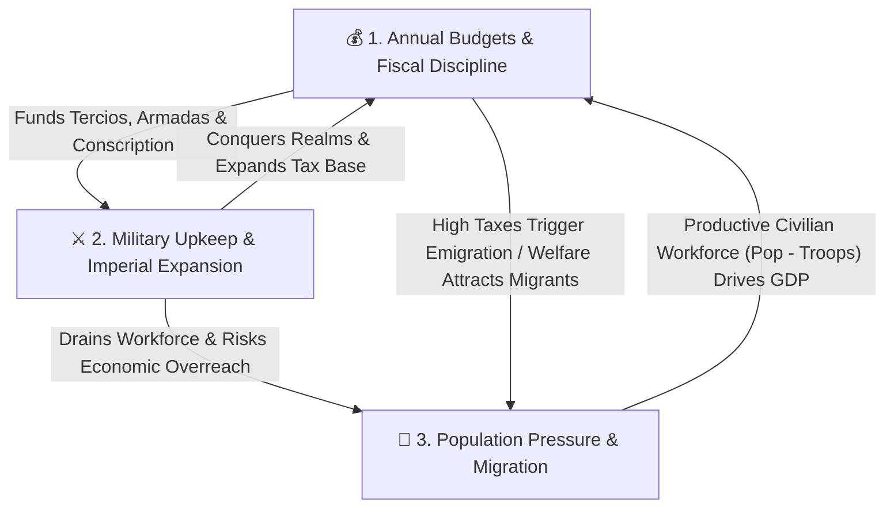
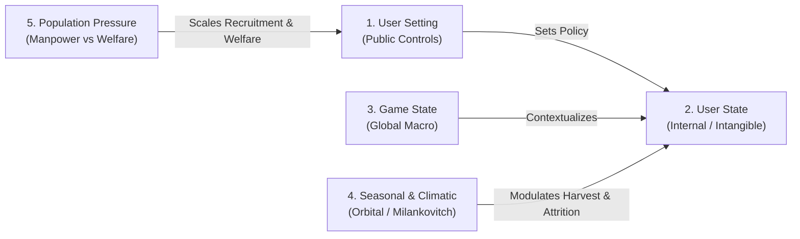
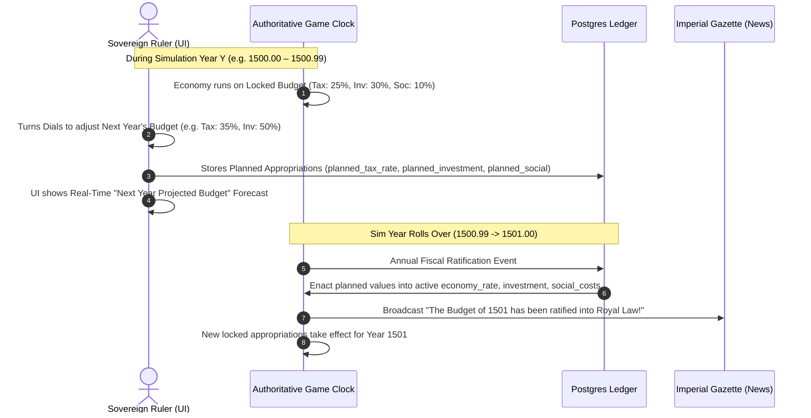
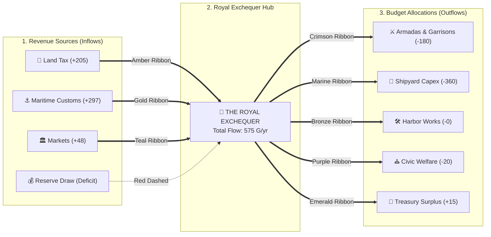
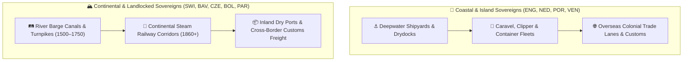
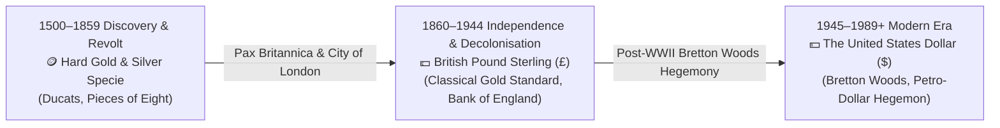
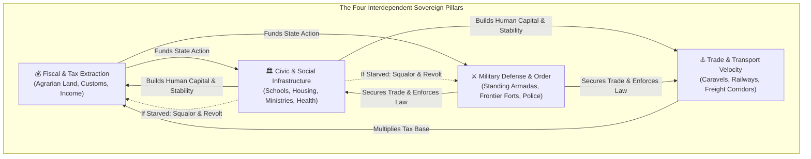
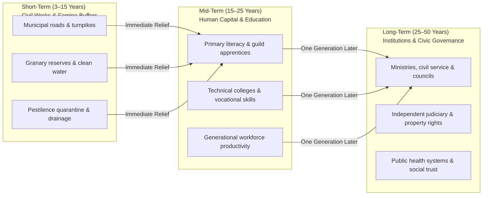

# Multi-Era Macroeconomic, Fiscal & Demographic Architecture

This skill defines the core economic simulation model and the progressive, era-gated financial instruments that govern empire building in **Kingdom Conquest**.

---

## 1. The Three Core Gameplay Conflicts

The grand strategy loop is driven by the tension between three interdependent pillars:



1. **Budgets & Fiscal Discipline**:
   - Players manage an **Annual Exchequer Budget** comparing **Last Year's Actual Expenditure & Revenue** against **This Year's Planned Allocations**.
   - Prudent budgeting protects currency stability, funds infrastructure/markets, and builds gold reserves that enable future military campaigns.
   - **Economic Overreach**: Expanding military commitments beyond fiscal capacity starves capital investment, triggers troop desertion, or forces confiscatory taxation.

2. **Military & Imperial Maintenance**:
   - Recruiting standing armies and border garrisons incurs **continuous annual upkeep** (`troops * troopUpkeep`) and removes citizens from the productive civilian workforce (`workforce = population - troops`).
   - Active warfare inflicts frontline attrition (~8% annually) and triggers **continuous conscription**, draining both gold reserves and civilian population.
   - **Diplomacy as a Strategic Shield**: Sending envoys and forging alliances requires upfront tribute/gifts but prevents ruinous multi-front wars.

3. **Population Pressure, Wealth Factor & Segmented Migration**:
   - **Population Pressure (`0–100%`)**: Rises as population density approaches infrastructure capacity or when military mobilization strips the civilian economy. High pressure requires infrastructure expansion and social spending.
   - **Variable Wealth Factor ($W \in [0.0, 1.0]$) & Wealthy Percentage ($P_{\text{wealthy}} \in [2\%, 18\%]$)**:
     - The population is segmented into the **Wealthy Merchant Class** and the **General Settler Populace**.
     - $P_{\text{wealthy}} = 0.02 + W \times 0.16$, where $W$ is driven by GDP per capita, commercial markets tier, infrastructure level, treasury gold solvency, and merchant entrepreneurial pride.
   - **Empirical Taxation Thresholds**:
     1. **Capital Haven (`taxRate <= 20%`)**: Attracts foreign capital and wealthy merchant relocations (`wealthy_migration > 0`), injecting fresh gold specie into the national treasury (`+5 gold/wealthy immigrant`).
     2. **Fair Prosperity (`21% <= taxRate <= 35%`)**: Civic sweet spot. Encourages steady family, artisan, and settler immigration (`general_migration > 0`). Wealthy remain content with zero flight.
     3. **Moderate / Normal (`36% <= taxRate <= 58%`)**: Standard tax burden. Migration is neutral, stimulated primarily by cathedral/guild social spending (`social_costs`) and infrastructure.
     4. **Heavy Drag (`59% <= taxRate <= 68%`)**: Burdensome taxes blunt natural demographic growth and cause marginal merchants and settlers to seek opportunities abroad.
     5. **Extreme Wealth Flight (`taxRate > 68%`)**: Confiscatory taxation! The wealthy migrate away first and fastest (`wealthy_migration < 0`), triggering **Capital Flight** that drains treasury specie reserves (`-10 gold/fleeing wealthy citizen`) and degrades entrepreneurial pride. General citizens also emigrate at an accelerated rate.

---

## 2. Layer-by-Layer Era Evolution Roadmap

The fiscal model begins as a disciplined hard-specie ledger in the early eras and unlocks progressively more sophisticated—and dangerous—sovereign finance mechanisms as history advances. Every layer is implemented incrementally with dedicated unit and integration tests.

| Layer | Historical Era(s) | Years | Fiscal Regime | Key Financial Instruments & Risks |
| :--- | :--- | :--- | :--- | :--- |
| **Layer 1** | `discovery` & `revolt` | 1500–1859 | **Balanced-Budget Specie Regime** | Hard gold specie; **Zero-Deficit Rule**; automatic discretionary rationing; tax-driven migration |
| **Layer 2** | `independence` | 1860–1919 | **World Bank Credit Facility** | Sovereign loans; controlled budget deficits; interest service; debt ceilings; default penalties |
| **Layer 3** | `decolonisation` | 1920–1988 | **Sovereign Bond Markets** | Short/long-term government bonds; dynamic yield curves; credit ratings; rollover & inflation risk |
| **Layer 4** | `modern` | 1989+ | **Securitized & Derivative Markets** | Derivatives, CDOs, CDSs, Inflation-Linked Securities (TIPS/Gilts); leverage multipliers; systemic contagion |

---

### Layer 1: Hard-Specie Balanced Budgets & Historical Fiscal Archetypes (1500–1859 — *Implemented*)

In the **Age of Discovery** and **Age of Revolt**, sovereign credit institutions do not yet exist. Kingdoms operate strictly on hard gold ducats and annual balanced budgets.

Crucially, **income tax did not exist** (first invented in Britain in 1799). Government revenue was derived from **customs tariffs (*Tonnage & Poundage*), the royal domain, monopolies/privateering, and feudal land taxes**. Furthermore, different kingdoms had vastly different fiscal architectures and constraints:

#### Country-Specific Fiscal Archetypes & Variances Matrix

| Realm Code | Realm Name | Fiscal Archetype | Agrarian Tax Mod (`tax_mod`) | Maritime Trade Mod (`trade_mod`) | Strategic Dilemma & Revenue Source |
| :--- | :--- | :--- | :--- | :--- | :--- |
| **`ENG`** | Kingdom of England | `maritime` | **0.50** | **1.80** | **Customs & Shipping:** Parliamentary limits on land taxes; relies heavily on port customs (*Tonnage & Poundage*), wool duties, and overseas caravel expeditions. |
| **`ESP`** | Crown of Spain | `bullion_monopoly` | **0.85** | **1.40** | **Silver Monopoly & Overstretch:** *Alcabala* sales tax and *Quinto Real* (Royal Fifth); massive silver influx offset by heavy garrison maintenance abroad (*Tercios* in Flanders/Italy). |
| **`POR`** | Kingdom of Portugal | `maritime` | **0.55** | **1.75** | **Spice Route Pioneer:** Small home population, reliant on Cape Route trade posts (*Feitorias*) and naval spice monopolies. |
| **`FRA`** | Kingdom of France | `agrarian_bureaucracy` | **1.30** | **0.65** | **Agrarian Leviathan:** Massive peasant population subject to the direct *Taille* and salt *Gabelle*; high continental manpower but slow early oceanic shipping. |
| **`VEN`** | Republic of Venice | `merchant_republic` | **0.15** | **2.50** | **Plutocratic Maritime Empire:** Negligible agrarian base; 90%+ income is spice/silk transit tariffs and salt monopolies (*Stato da Màr*). High per-capita wealth, vulnerable to Ottoman naval wars. |
| **`GEN`** | Republic of Genoa | `merchant_republic` | **0.20** | **2.30** | **Merchant Bankers:** Maritime trade and sovereign banking hub; low land tax, high commercial tariff multiplier. |
| **`NED`** | Dutch Republic | `maritime` | **0.45** | **2.00** | **Commercial Entrepot:** Advanced capital markets, flute shipping, and chartered VOC monopolies; supreme trade velocity. |
| **`POL`** | Poland-Lithuania | `noble_commonwealth` | **0.40** | **1.10** | **Szlachta Immunity:** Rich Baltic grain exporter via Danzig, but noble tax exemptions under *Nihil Novi* starve the Royal Treasury of cash. |
| **`OTT`** | Ottoman Empire | `imperial_fief` | **1.10** | **1.20** | **Imperial Crossroads & Fiefs:** Non-Muslim poll taxes (*Jizya/Cizye*) and *Kharaj* land tribute; military maintained via *Timar* land grants rather than cash payroll. |
| **`RUS`** | Tsardom of Muscovy | `agrarian_bureaucracy` | **1.20** | **0.60** | **Autocratic Land Extraction:** High serf extraction and fur tribute (*Yassak*); landlocked with minimal maritime tariffs. |
| **`HRE`** | Holy Roman Empire | `agrarian_bureaucracy` | **0.90** | **0.90** | **Fragmented Imperial Diet:** Fragmented estates and tolls; moderate balanced baseline. |
| **`SCO`** | Kingdom of Scotland | `noble_commonwealth` | **0.50** | **1.00** | **Clan Autonomy:** Low central crown extraction; relies on modest port trade. |
| **`DEN`** | Kingdom of Denmark | `maritime` | **0.60** | **1.50** | **Sound Toll Gatekeeper:** Controls Baltic entry tariffs (*Øresundstolden*). |
| **`SWE`** | Kingdom of Sweden | `balanced` | **0.80** | **1.20** | **Baltic Copper & Iron:** Falu copper mine royalties and Baltic coastal trade. |

#### Calibrated Macroeconomic Specie Scale (1500 Discovery Era)
1. **Agrarian Land Extraction Baseline:**
   - Calibrated at `baseProductivity = 0.0002` gold output per capita.
   - For England (pop 4,500,000), a standard 50% extraction effort yields `4,500,000 * 0.0002 * 0.50 * 0.50 (tax_mod) = ~225 gold/cycle`.
   - Peasant tithes in 1500 were mostly in kind (grain, livestock) and did not automatically convert into spendable gold specie in royal vaults.
2. **Maritime Trade as the Crown's Essential Lifeblood:**
   - To make building shipping an indispensable strategic imperative, maritime trade yields must be lucrative relative to ship construction capex.
   - Each completed expedition fleet grants $+5\%$ compounded yield, generating:
     $$\text{Trade Revenue} = (\text{colonialYield} \times 1500.0 + \text{markets} \times 12) \times \text{ProductivityFactor} \times (1.0 + \text{colonialYield}) \times \text{CommercialVelocity} \times \text{trade\_mod}$$
   - For England (`trade_mod = 1.80`), a single completed caravel fleet earns **$\approx 135\text{ gold/year}$** in recurring customs and tariffs on a $360\text{ G/year}$ capex investment (a **19%–25% annual return on invested capital**).
   - 3 active fleets generate **$400+\text{ gold/year}$**, exceeding the entire agrarian land tax take, mirroring Elizabethan reliance on maritime privateering, customs (*Tonnage & Poundage*), and chartered shipping!

1. **Annual Budget Statement**:
   - Tracks **Last Year's Ledger** (`last_tax_revenue`, `last_market_income`, `last_military_exp`, `last_social_exp`, `last_investment_exp`, `last_total_exp`, `last_budget_balance`, `last_migration`).
   - Projects **This Year's Budget** from current tax rates, market tiers, standing troop counts, and investment/social allocations.
2. **Strict No-Deficit Enforcement (`EnforceBalancedBudget`)**:
   - Planned annual expenditure (`military_upkeep + social_spend + investment_spend`) **cannot exceed** annual revenue (`tax_revenue + market_revenue`).
   - Priority of payment:
     1. **Standing Military Upkeep** is paid first from available revenue.
     2. **Discretionary Outlays** (`investment` and `social_costs`) are proportionally rationed/capped to fit within remaining revenue (`total_revenue - military_upkeep`).
     3. If military upkeep alone exceeds total revenue and treasury reserves reach `0`, unpaid troops automatically demobilize/desert until military expenditure matches revenue.
   - Result: `budget_balance >= 0` and `resources >= 0` at all times during Layer 1.
3. **Demographic Migration**:
   - `ComputeMigration(population, taxRate, socialCosts, infrastructure)` calculates annual net migration:
     - `taxRate > 60%`: progressive emigration scaling quadratically with excess tax burden.
     - `taxRate <= 35%`: immigration bonus scaling with social welfare and infrastructure tiers.
     - Emigrants from high-tax realms partially redistribute to low-tax kingdoms in `TickEconomyStep`.

---

### Layer 2: The World Bank & Sovereign Loans (1860–1919 — *Planned Next*)

Entering the **Age of Independence** (`year >= 1860`), industrial warfare and railway/harbor expansion outgrow annual tax receipts. A global **World Bank** is established:

1. **Deficit Spending Unlocked**:
   - Governments may run an annual budget deficit if covered by an active **World Bank Credit Line** or **Sovereign Term Loan**.
2. **World Bank Mechanics**:
   - **Credit Limit**: `MaxBorrowingCapacity = 2.5 * AnnualGDP`.
   - **Interest Rate**: `LoanRate = BaseWorldBankRate (4.0%) + CountryRiskPremium`, where the risk premium rises with the country's `DebtToGDPRatio` and active war status.
   - **Mandatory Debt Service**: Annual interest + scheduled principal amortization is deducted as a **First-Lien Priority** before military upkeep or discretionary spending.
   - **Structural Adjustment / Default**: If a kingdom fails to service its World Bank loan, the World Bank freezes new credit, imposes an automatic tariff garnish on market revenues, and triggers severe domestic unrest.

---

### Layer 3: Sovereign Bond Markets (1920–1988 — *Planned*)

In the **Age of Decolonisation** (`year >= 1920`), states transition from bilateral World Bank loans to open **Sovereign Bond Markets**:

1. **Bond Issuance & Tranches**:
   - Governments can issue **2-Year Treasury Bills**, **5-Year Exchequer Notes**, and **10-Year Sovereign Bonds** to fund large-scale deficits.
2. **Market-Driven Yield Curves**:
   - Bond yields (`CouponRate`) float dynamically based on:
     - `DebtToGDP = TotalBondPrincipal / GDP`
     - `InflationRate` (investors demand positive real yields)
     - `CurrencyValue` stability
3. **Rollover & Bond Vigilante Risk**:
   - Maturing bonds must be repaid from the treasury or rolled over by issuing new bonds at prevailing market yields.
   - Excessive deficit spending spikes yields ("Bond Vigilantes"), crowding out military and social budgets.

---

### Layer 4: Modern Financial Instruments & Systemic Risk (1989+ — *Planned*)

In **The Modern Age** (`year >= 1989`), globalized capital markets introduce high-powered financial engineering and systemic tail risks:

1. **Inflation-Linked Securities (TIPS / Index-Linked Gilts)**:
   - Sovereign bonds whose principal and coupon payments automatically index to `InflationRate`.
   - Protects bondholders and lowers initial borrowing costs during low inflation, but causes explosive fiscal debt-service spirals if wartime deficits or loose monetary policy trigger inflation spikes.
2. **Collateralized Debt Obligations (CDOs)**:
   - Pools of sovereign and commercial trade obligations packaged into Senior, Mezzanine, and Equity tranches.
   - Boosts domestic `MarketRevenue` and `Investment` multipliers during economic expansions, but suffers correlated tranche wipeouts if any underlying trading partner defaults or enters recession.
3. **Credit Default Swaps (CDSs)**:
   - Insurance contracts written on sovereign debt default risk.
   - Players can buy CDS protection to hedge against rival empires' defaults—or speculate via "naked CDS" positions—while sellers collect annual premium income but face catastrophic margin calls if a sovereign default occurs.
4. **Derivatives & Systemic Contagion**:
   - Interest-rate swaps and currency forwards amplify treasury returns up to a leverage factor $L \in [1, 5]$, but introduce **Mark-to-Market Margin Calls** and cross-border financial contagion when market volatility (`MarketRisk`) swings negative.

---

## 3. Testing & Verification Protocol

Every macroeconomic layer must maintain 100% pass rates across `go test ./...` before advancing to the next layer:

1. **Layer 1 Invariants (Current)**:
   - `TestBalancedBudgetNoDeficit`: Verifies that kingdoms with specie reserves can fund deficits from treasury reserves, while broke kingdoms (`resources == 0`) have outlays strictly capped to revenue.
   - `TestTaxDrivenMigration`: Verifies that punitive tax rates (`> 60%`) cause negative net migration (emigration), while low tax rates (`<= 30%`) with infrastructure attract positive immigration.
   - `TestPopulationPressure`: Verifies that high population density without infrastructure or excessive military mobilization raises `PopulationPressure`.
   - `TestLastYearExpenditureTracking`: Verifies that annual simulation ticks persist Last Year's actual revenue, expenditure breakdown, and migration for display in the player's Budget Ledger.

---

## 4. Administrative Variable Taxonomy & Internal Dynamic Rules

To enable rigorous scenario tuning and simulation balance, all game mechanics adhere to a 5-tier variable classification accessible in real time via the **Admin Game Monitor Panel**:



### 1. The 5 Variable Classes

| Class | Scope | Visibility | Key Variables | Description |
| :--- | :--- | :--- | :--- | :--- |
| **User Setting** | Kingdom | Public (Player Modal) | `Tax Rate (%)`, `Investment (%)`, `Social Costs (%)`, `Central/Border Troops`, `Fortifications (N/S/E/W)` | Direct policy levers controlled by sovereign rulers. |
| **User State** | Kingdom | Internal (Admin Only) | `Entrepreneurial Pride (%)`, `Military Delayed Costs`, `Fiscal Stress Index`, `Specie Reserves`, `Real GDP`, `Inflation` | Hidden psychological and structural balance sheet variables altered by gameplay. |
| **Game State** | Global | Universal | `Authoritative Era`, `Sim Year`, `Chrono Scale`, `Global Trade Liquidity`, `Active Wars`, `Fiscal Regime` | Macro-environmental constants and systemic financial infrastructure. |
| **Seasonal & Climatic** | Global / Regional | Universal | `Season (Spring/Summer/Autumn/Winter)`, `Milankovitch Factor`, `Little Ice Age Phase`, `Harvest Yield Multiplier`, `Winter Severity Modifier` | Astronomical and climatological cycles that swing crop yields, trade velocity, and military winter logistics. |
| **Population Pressure** | Kingdom / Regional | Telemetry | `Carrying Capacity Ratio`, `Manpower Recruitment Discount`, `Welfare Squalor Burden`, `Birth Growth Dampener` | Demographic balance: abundant labor cheapens troop recruitment but escalates mandatory civic welfare. |

---

### 2. Core Internal Dynamics (Feature/Internals)

#### A. Entrepreneurial Pride & Risk-Taking Propensity
- **Concept**: An intangible national index representing merchant confidence, civic ambition, and commercial vigor ($0\% \text{ to } 100\%$, initialized at $100\%$).
- **Taxation Drag**: High tax rates ($> 40\%$, escalating above $60\%$) demoralize private enterprise, reducing Entrepreneurial Pride over multi-year periods.
- **Economic Impact**:
  - High Pride ($> 80\%$): Multiplies market profits and cushions commercial risk swings.
  - Crushed Pride ($< 50\%$): Suppresses private trade output, accelerates capital flight, and raises commercial volatility.
- **Recovery**: Recovers gradually ($+1.5\% \text{ to } +2.5\% \text{ annually}$) when taxes remain competitive ($\le 35\%$) and the treasury maintains positive specie reserves.

#### B. Delayed Military Investment Tails & Pension Liabilities
- **Concept**: When a player invests heavily in army expansion, recruitment, or fortifications, the fiscal burden does **not** vanish once recruits join the ranks.
- **Mechanism**: Every troop recruitment batch and fortification expansion commits a **Delayed Military Liability** (munitions contracts, officer pensions, armory upkeep, supply depot maintenance).
- **Decay Profile**: Delayed liabilities decay by $\sim 20\%$ annually ($t_{1/2} \approx 3.1 \text{ years}$).
- **Gameplay Effect**: Overbuilding the military binds the crown's budget for years into the future; peacetime does not immediately alleviate accumulated defense commitments.

#### C. Gradual Demographic Drag (Multi-Year Lag)
- **Concept**: Confiscatory taxation ($> 60\%$) blunts population growth gradually rather than triggering unrealistic sudden depopulation.
- **Mechanism**:
  - Blunts natural birth growth from $+1.5\%$ toward zero or slight negative contraction (delayed family formation).
  - Emigration compounds over $3\text{–}5$ years of sustained oppression, allowing players a window to correct punitive fiscal mistakes before demographic collapse occurs.

#### D. Seasonal Milankovitch & Climatic Swings
- **Astronomical Seasons**: Calculated from the fractional simulation year:
  - `Spring [0.00 – 0.25)`: Sowing season, moderate trade recovery.
  - `Summer [0.25 – 0.50)`: Campaigning peak, maximum maritime commerce velocity.
  - `Autumn [0.50 – 0.75)`: Harvest cycle; `HarvestYieldMultiplier` applies a tax windfall or shortfall.
  - `Winter [0.75 – 1.00)`: Winter freezing; applies `WinterSeverityModifier` increasing standing military logistics upkeep and front-line attrition.
- **Little Ice Age & Solar Variations (1500–1850)**:
  - Spörer Minimum ($\sim 1500$) and Maunder Minimum ($1645\text{–}1715$) apply long-wave cooling, increasing winter severity and elevating famine risks.

#### E. Population Pressure: Manpower vs. Welfare Duality
- **Manpower Recruitment Advantage**: Kingdoms with massive populations (e.g. France, Ottoman Empire) benefit from plentiful recruits; recruitment gold costs scale down by up to $50\%$.
- **Welfare Squalor Burden**: Larger populations require proportionally higher baseline Cathedral and Social Welfare spending. If underfunded, urban squalor accelerates epidemic vulnerability and dampens economic productivity.

#### F. Colonial & Capital Investment Gestation Pipeline
- **Concept**: In the Age of Discovery, laying down caravels, outfitting expeditions, and establishing overseas trade outposts cannot yield instantaneous GDP dividends. Capital projects require continuous funding over a **Gestation Period** before returning merchant yields.
- **The Capital Pipeline ($0\% \to 100\%$ Gestation)**:
  - Annual investment allocations accumulate progress toward completing active flotillas and trading posts.
  - Completion requires sustained capital outlays over an **Era-Dependent Gestation Period** ($T_{\text{gestation}}$).
- **The Sunk-Cost & Abandonment Decay Penalty**:
  - If a player abruptly slashes or zeroes the investment dial mid-project, unfinished ships rot in drydocks, dockworkers disperse, and supply chains spoil.
  - **Decay Rate**: If funding drops to zero, uncompleted gestation progress degrades at $-25\%$ per simulation year. If not re-funded within 1–2 years, all invested capital is forfeited with zero trade return.
- **Era Production & Capital Expenditure Cost Matrix**:
  As shipbuilding, propulsion, navigation, and telecommunications advance, the required gestation delay shrinks, while annual capital expenditure increases (greater spending concentrated over a shorter production time):
  - **Age of Discovery (1500–1749)**: $T_{\text{gestation}} = 5.0\text{ years}$ · $150\text{ gold/year}$ at $100\%$ ($750\text{ gold}$ total). Wooden caravels, hand-hewn oak, wind circumnavigation.
  - **Age of Revolt (1750–1859)**: $T_{\text{gestation}} = 2.5\text{ years}$ · $360\text{ gold/year}$ at $100\%$ ($900\text{ gold}$ total). Armed Indiamen, copper sheathing, cannon foundries.
  - **Age of Independence (1860–1919)**: $T_{\text{gestation}} = 1.25\text{ years}$ · $800\text{ gold/year}$ at $100\%$ ($1,000\text{ gold}$ total). Steam clippers, boiler plates, telegraph cables.
  - **Age of Decolonisation (1920–1988)**: $T_{\text{gestation}} = 0.5\text{ years}$ · $2,400\text{ gold/year}$ at $100\%$ ($1,200\text{ gold}$ total). Diesel bulk freighters, specialized tankers.
  - **The Modern Age (1989+)**: $T_{\text{gestation}} = 0.35\text{ years}$ · $4,500\text{ gold/year}$ at $100\%$ ($1,575\text{ gold}$ total). Automated modular container vessels, satellite navigation.
- **Treasury Reserve Adequacy Check & Solvency Enforcement**:
  - In pre-modern eras (1500–1988), deficit financing is strictly disallowed under the hard-specie and sovereign balanced budget rules.
  - When declaring an investment rate $I\%$, the kingdom's treasury reserves must be adequate to support the full multi-year production commitment:
    $$\text{RequiredGold}(I) = \text{BaseAnnualCost} \times T_{\text{gestation}} \times \left(\frac{I}{100.0}\right)$$
  - If $\text{resources} < \text{RequiredGold}(I)$, the exchequer cannot support the expedition spending and the game **does not allow it**, capping the maximum affordable investment rate to $I_{\max} = \lfloor (\text{resources} / \text{TotalCost}_{100}) \times 100 \rfloor$.
  - In **The Modern Age (1989+)**, sovereign deficit financing is unlocked: nations may run budget deficits and fund projects through debt even with depleted reserves.
- **Conquest & Territory Re-allocation**:
  - Conquering coastal provinces grants access to captured shipyards and overseas colonial trade lanes, accelerating the investor's cumulative trade productivity ceiling.

---

## 5. Era-Specific Strategic Commodity Matrix

As historical ages roll over, the physical resources that power imperial expansion and economic supremacy evolve. Territories possess latent resource deposits that unlock and reshape national strength in their respective eras:


| Era | Primary Strategic Commodities | Economic Driver & Gameplay Impact | Historical Context |
| :--- | :--- | :--- | :--- |
| **Discovery** (1500–1749) | **Gold, Silver Bullion, Spices, Silk** | **Treasury Specie Backing**: High gold reserves directly strengthen currency value and allow funding expeditions and mercenary tercios without debasement. | Spanish Silver Fleets (Potosí), Portuguese Spice Monopoly (Malacca/Goa). |
| **Revolt** (1750–1859) | **Naval Timber, Sugar, Tobacco, Cotton** | **Mercantile Windfalls & Naval Capacity**: Access to ship timber determines max armada size; plantation cash crops multiply market export liquidity. | Caribbean sugar trade, American cotton/tobacco, Baltic naval stores. |
| **Independence** (1860–1919) | **Coal, Iron Ore, Steel** | **Industrial Multiplier**: Coal deposits fuel rail logistics, accelerate factory productivity, and power steam-driven naval ironclads. Territories lacking coal suffer severe industrial penalties and must import at exorbitant prices. | Industrial Revolution, Ruhr Valley, British Welsh Coalfields, Pittsburgh steel. |
| **Decolonisation** (1920–1988) | **Crude Oil, Bauxite (Aluminum), Rubber, Uranium** | **Mechanized Warfare & Energy**: Oil fields dictate mechanized army and air force mobility; lack of domestic oil reserves triggers military paralysis during prolonged wars unless secured by conquest or diplomacy. | Middle Eastern concessions, Baku oil, WWII resource blockades. |
| **Modern** (1989+) | **Semiconductors, Rare Earths, Natural Gas** | **High-Tech Capital Multiplier**: Microchip foundries and rare earth monopolies multiply financial sector productivity, telecommunications velocity, and smart defense systems. | Taiwan/East Asian foundries, global rare earth supply chains, LNG pipelines. |

---

## 6. Multi-Era Country Fiscal Archetypes & Asymmetric Variances (All 5 Eras, 200+ Realms)

To make gameplay strategically differentiated across all 200+ countries and across all historical transitions, kingdoms are not treated as generic homogeneous landmasses. Each country is governed by a **Fiscal Archetype** defining how its society generates wealth, how its state extracts revenue, and its inherent economic advantages and vulnerabilities.

### A. The 10 Universal Macroeconomic Archetypes

```mermaid
flowchart TD
    subgraph Early Eras 1500–1859
        ME["⚓ 1. Maritime Empire\n(Customs, Shipping, Fleets)"]
        AB["🌾 2. Agrarian Bureaucracy\n(Peasant Taille, Land Dues)"]
        BM["👑 3. Bullion Monopoly\n(Treasure Fleets, Heavy Army Upkeep)"]
        MR["🏛️ 4. Merchant Republic / Hub\n(Ultra Trade Velocity, Zero Land Depth)"]
        NC["📜 5. Noble Commonwealth\n(Noble Tax Immunity, Grain Export)"]
        IF["🕌 6. Imperial Fief\n(Timar Fiefs, Jizya Poll Tax)"]
    end

    subgraph Industrial & Modern Eras 1860–1989+
        IP["🏭 7. Industrial Powerhouse\n(Factory Output, Rail Infrastructure)"]
        CR["🛢️ 8. Commodity Rentier\n(Oil/Mineral Concessions, Risk Swings)"]
        PD["🏗️ 9. Post-Colonial Developmental\n(Foreign Exchange Drag, Debt Exposure)"]
        BS["⚖️ 10. Balanced Sovereign\n(Standard Mixed Economy)"]
    end
```

| Archetype Key | Archetype Title | Agrarian Tax Mod (`tax_mod`) | Maritime Trade Mod (`trade_mod`) | Industry / Capex Mod | Strategic Dilemma & Playstyle |
| :--- | :--- | :--- | :--- | :--- | :--- |
| `maritime_empire` | **Maritime Empire** | **0.45 – 0.60** | **1.70 – 2.10** | **1.25** | **Customs & High Seas**: Weak peasant extraction; exchequer lives on port tariffs (*Tonnage & Poundage*), shipping capex returns, and naval dominion. (e.g. England, Netherlands, Portugal, Denmark). |
| `agrarian_bureaucracy` | **Agrarian Bureaucracy** | **1.20 – 1.35** | **0.60 – 0.75** | **0.85** | **Peasant Leviathan**: Heavy direct land taxation (*Taille*, serf extraction) and salt monopolies; massive standing army manpower, but slow early ocean commerce. (e.g. France, Muscovy/Russia, Qing China, Austria, Prussia). |
| `bullion_monopoly` | **Bullion Monopoly** | **0.80 – 0.90** | **1.35 – 1.50** | **1.10** | **Silver Monopoly & Overstretch**: Treasure fleet windfalls (*Quinto Real*) and sales taxes (*Alcabala*); highly vulnerable to privateering and burdened by $+35\%$ foreign army upkeep (*Tercios*). (e.g. Spain). |
| `merchant_republic_hub` | **Merchant Republic / Financial Hub** | **0.10 – 0.25** | **2.20 – 2.80** | **1.50** | **Plutocratic Trade Hub**: Negligible agrarian territory; $90\%+$ revenue from spice/silk transit tariffs, banking, and sovereign credit. Extreme per-capita wealth, but zero territorial depth and vulnerable to naval blockades. (e.g. Venice, Genoa, Ragusa; later Singapore, Switzerland, Luxembourg). |
| `noble_commonwealth` | **Noble Commonwealth** | **0.35 – 0.50** | **0.90 – 1.15** | **0.90** | **Magnate Anarchy**: Rich grain exports, but noble estates enjoy constitutional tax immunity (*Nihil Novi*, Golden Liberty); Crown treasury is chronically starved of cash unless the King grants concessions. (e.g. Poland-Lithuania, early Scotland, Hungary). |
| `imperial_fief` | **Imperial Fief** | **1.05 – 1.20** | **1.10 – 1.30** | **1.00** | **Crossroads Fiefdom**: Religious poll taxes (*Jizya/Cizye*) and agricultural tribute (*Kharaj*); military maintained via land grants (*Timar*) rather than cash treasury payroll. (e.g. Ottoman Empire, Mughal Empire, Safavid Persia). |
| `industrial_powerhouse` | **Industrial Powerhouse** | **0.70 – 0.85** | **1.40 – 1.70** | **1.80 – 2.20** | **Smokestack Hegemon**: Emerges in Revolt/Independence eras. Massive factory output and rail infrastructure multipliers; tax base shifts to corporate profits and urban wage labor. (e.g. 19th-c. Britain, Germany, USA, Meiji Japan). |
| `commodity_rentier` | **Commodity Rentier** | **0.30 – 0.50** | **1.80 – 2.40** | **1.10** | **Resource Petrostates & Mining**: Emerges in Independence/Modern eras. State revenue dominated by oil, copper, or nitrate concessions; subject to massive cyclical risk swings when global prices slump. (e.g. Venezuela, Saudi Arabia, Gulf States, Chile, Nigeria). |
| `post_colonial_developmental` | **Post-Colonial Developmental** | **0.80 – 1.00** | **0.85 – 1.10** | **1.00** | **Nation-Building Frontier**: Emerges in Decolonisation era. Intense capital infrastructure and welfare needs, high vulnerability to foreign exchange reserves drain and debt default. (e.g. India, Indonesia, Ghana, Egypt, Kenya). |
| `balanced_sovereign` | **Balanced Sovereign** | **1.00** | **1.00** | **1.00** | **Mixed Sovereign Baseline**: Standard balanced profile for independent regional powers and transitional states. |

### B. Global Era Progression & Dynamic Country Mapping

1. **Era Unlock Re-Classification**:
   - When a nation unlocks or advances into a new historical era (e.g. Great Britain from `discovery` maritime to `revolt` industrial powerhouse; United States unlocking in 1776 as revolutionary industrial state), its `fiscal_archetype`, `tax_mod`, and `trade_mod` dynamically update to reflect its evolving economy.
2. **Comprehensive 200+ Country Rule**:
   - Every country row in `countries` carries explicit database columns:
     - `fiscal_archetype VARCHAR(50)`
     - `tax_mod DOUBLE PRECISION DEFAULT 1.0`
     - `trade_mod DOUBLE PRECISION DEFAULT 1.0`
   - When new nations emerge (Latin American republics in 1860, post-WWI states in 1918, African/Asian nations in 1960), the authoritative engine seeds their historical profile automatically.

---

## 7. Next-Period Budget Appropriation Model (Strategic Annual Budget Cycle)

### A. The Core Principle: Appropriations Set Next Year's Budget

In historical exchequers, monarchs, chancellors, and parliaments do not tweak running taxes from second to second. Budgets are debated, appropriated, and enacted as **Annual Finance Acts** for the **upcoming fiscal year**.

To give players strategic depth and prevent twitchy slider exploitation:

$$\text{Current Running Year } Y: \text{Governed by Locked Appropriations } (\tau_Y, I_Y, S_Y)$$
$$\text{Imperial Dials in UI}: \text{Appropriate Next Year's Budget } (\tau_{Y+1}^*, I_{Y+1}^*, S_{Y+1}^*)$$



### B. State Variables & Data Schema
- **Current Running Values (Locked during year $Y$)**:
  - `economy_rate int64`: Active tax extraction rate currently running through the economy.
  - `investment int64`: Active capex / shipyard allocation funding current projects.
  - `social_costs int64`: Active cathedral / welfare spending.
- **Planned Appropriations (Target for year $Y+1$)**:
  - `planned_economy_rate int64 DEFAULT 50`: Planned tax rate set on the dial.
  - `planned_investment int64 DEFAULT 0`: Planned expedition / capex rate set on the dial.
  - `planned_social_costs int64 DEFAULT 0`: Planned social welfare rate set on the dial.

### C. Annual Ratification Lifecycle & Engine Rollover
1. **Intra-Year Policy Deliberation**:
   - As the chronometer ticks through year $Y$, the player can freely adjust planned dials.
   - The UI displays **Next Year Projected Budget** side-by-side with **Current Enacted Actuals**.
   - If the player sets an unsustainable planned investment, the UI warns: *"⚠️ Planned 60% investment exceeds reserves; will be capped at rollover."*
2. **The Annual Rollover Event (`TickEconomyStep` when `yearRolledOver == true`)**:
   - The authoritative engine ratifies the budget:
     ```go
     c.EconomyRate = c.PlannedEconomyRate
     c.Investment = c.PlannedInvestment
     c.SocialCosts = c.PlannedSocialCosts
     ```
   - Dispatches a historical chronicle entry:
     *"📜 ROYAL EXCHEQUER: The Budget of [Year] has been enacted into law (Tax: %d%% · Expeditions: %d%% · Social: %d%%)."*
   - Dynamic investor pride begins relaxing toward the new tax rate's target curve over the upcoming $1\text{–}2$ years.

---

## 8. Budget Flows Telemetry: Mini-Spreadsheet & Sankey Diagram Architecture

To make fiscal management intuitive, the Imperial Command Center integrates two complementary financial tools inside the **Exchequer & Trade Bay (Bay 1)**:

### A. The Dual-Period Financial Statement (Mini-Spreadsheet)

A structured accounting ledger comparing **Current Period Enacted** vs **Next Period Projected** with variance ($\Delta$):

```
+------------------------------------------------------------------------------------------------+
|  ROYAL EXCHEQUER LEDGER & BUDGET APPROPRIATIONS (Anno Domini 1502)                             |
+------------------------------------+---------------------+--------------------+----------------+
|  LINE ITEM                         |  CURRENT YEAR (1502)|  NEXT YEAR (1503)  |  VARIANCE (Δ)  |
+------------------------------------+---------------------+--------------------+----------------+
|  REVENUE INFLOWS:                  |                     |                    |                |
|    🌾 Crown Land & Agrarian Tax    |  +205 G             |  +287 G            |  +82 G (+40%)  |
|    ⚓ Port Customs & Tariffs       |  +297 G             |  +297 G            |    0 G (Flat)  |
|    🏛️ Domestic Chartered Markets   |   +48 G             |   +48 G            |    0 G (Flat)  |
|    💰 Domain Rents & Specie Return |   +25 G             |   +25 G            |    0 G (Flat)  |
|  --------------------------------- | ------------------- | ------------------ | -------------- |
|  TOTAL REVENUE (A)                 |  +575 G             |  +657 G            |  +82 G (+14%)  |
+------------------------------------+---------------------+--------------------+----------------+
|  APPROPRIATED OUTFLOWS:            |                     |                    |                |
|    ⚔️ Standing Armadas & Garrisons  |  -180 G             |  -180 G            |    0 G (Flat)  |
|    🚢 Colonial Shipyard Capex      |  -360 G (30%)       |  -480 G (40%)      | -120 G (+33%)  |
|    🛠️ Harbor & Guild Infrastructure|    -0 G             |    -0 G            |    0 G         |
|    ⛪ Cathedral & Civic Welfare    |   -20 G             |   -20 G            |    0 G         |
|  --------------------------------- | ------------------- | ------------------ | -------------- |
|  TOTAL EXPENDITURES (B)            |  -560 G             |  -680 G            | -120 G (+21%)  |
+------------------------------------+---------------------+--------------------+----------------+
|  NET FISCAL SOLVENCY (A - B):      |                     |                    |                |
|    👑 Net Annual Balance           |  +15 G (SURPLUS)    |  -23 G (DEFICIT)   |  -38 G         |
|    🏦 Treasury Specie Reserves     |   615 G             |   592 G            |  -23 G Drain   |
|    ⚖️ Fiscal Regime Status         |  BALANCED HARD SPEC |  ⚠️ HARD RATIONING |  Policy Alert  |
+------------------------------------+---------------------+--------------------+----------------+
```

### B. Interactive Steampunk Sankey Flow Diagram

Below the ledger, an illuminated fluid Sankey diagram visually maps the movement of ducats through the empire:



#### Canvas Architecture & Rendering Standards
1. **HTML5 `<canvas id="cc-budget-sankey">`**:
   - Rendered with high-DPI scaling directly inside Bay 1.
   - Steampunk aesthetic: dark parchment/slate background (`#0f172a`), brass framing rivets, and illuminated fluid ribbons.
2. **Ribbon Geometry & Proportions**:
   - Uses cubic Bezier curves (`ctx.bezierCurveTo`) connecting rectangular node anchors.
   - Ribbon thickness is proportional to ducat volume:
     $$W_{\text{ribbon}} = \max\left(3, \frac{\text{Amount}}{\text{TotalInflow}} \times H_{\text{usable}}\right)$$
3. **Color Palette**:
   - **Inflows**: Amber Gold (`#f59e0b`), Deep Gold (`#d97706`), Warm Yellow (`#fde047`).
   - **Military Outflows**: Imperial Crimson / Ruby (`#ef4444`, `#dc2626`).
   - **Expedition Capex**: Ocean Cyan / Deep Marine (`#06b6d4`, `#0284c7`).
   - **Infrastructure**: Burnished Bronze (`#b45309`).
   - **Social / Religious Welfare**: Byzantine Purple / Amethyst (`#a855f7`).
   - **Net Surplus / Savings**: Vibrant Emerald (`#10b981`).
   - **Deficit Draw**: Glowing Neon Red / Flame (`#f87171`).
4. **Interactivity**:
   - **Hover Inspection**: Hovering over any ribbon or node displays an illuminated tooltip:
     - e.g. *"⚓ Port Customs & Maritime Tariffs: +297 Ducats/yr (51.6% of Crown Revenue)"*
     - e.g. *"🚢 Colonial Expeditions: -360 Ducats/yr (64.3% of Exchequer Spending)"*
   - **Period Toggle Switch**: A brass toggle switch on the canvas:
     - `[ 🔘 Current Year Enacted (1502) | Next Year Projected (1503) ]`
     - Allows instant visual comparison of how next year's planned dial changes will reshape the flow ribbons before the budget is ratified.

---

## 9. Capital Asset Lifecycles, Depreciation & Era Obsolescence (Creative Destruction)

A foundational macroeconomic reality is that **physical and technological assets possess a finite competitive lifecycle**. What creates a superpower in one century becomes an obsolete liability in the next if the state fails to continually re-invest:


### A. The Principle of Era Obsolescence
1. **Asset Half-Life ($t_{1/2}$)**:
   - Capital assets built in early eras (e.g. wooden caravel fleets, early merchant markets) do not produce permanent yields indefinitely into modern times.
   - When the global timeline crosses an **Era Transition Boundary** (e.g. Discovery $\to$ Revolt in 1750, or Revolt $\to$ Independence in 1860):
     - Legacy assets suffer an **Era Obsolescence Depreciation**:
       $$\text{Effective Yield Bonus}_{E+1} = \text{Effective Yield Bonus}_E \times \delta_{\text{era}}$$
       where $\delta_{\text{era}} \approx 0.60\text{–}0.75$.
2. **Creative Destruction & Renewal Capex**:
   - To sustain high commercial velocity and market yields in a new era, empires cannot rest on their ancestral laurels.
   - They must re-invest capital through the era's updated investment matrix (e.g., converting wooden shipyards into ironclad drydocks, laying steam locomotive tracks, modernizing port container cranes).
   - This prevents early-game runaway snowballs: an empire that led in 1500 but stopped investing in 1860 will be overtaken by rising industrial powers.

---

## 10. Transport Infrastructure Duality: Maritime Fleets vs. Continental Rail Networks (Landlocked vs Sea-Going Dynamics)

As the game world expands across continents, geography dictates economic strategy. Landlocked realms cannot build sea-going caravels, but their economies are not crippled; their capital expenditures channel into **Overland Transport Corridors**:



### A. Weightings & Strategic Allocation
1. **Sea-Going Sovereigns (`is_island == true` or Coastline Ratio $> 0.40$)**:
   - Capex Dial ($I\%$) primarily funds **Naval Shipyards, Drydocks, and Merchant Fleets**.
   - Tariffs and trade income scale with oceanic trade velocity and colonial line completions.
   - Vulnerability: Naval blockades, privateering raids, maritime attrition.
2. **Landlocked Sovereigns (`is_island == false` and Coastline Ratio $== 0$)**:
   - Capex Dial ($I\%$) is automatically channeled by the exchequer into **Overland Transport Networks**:
     - *Discovery & Revolt (1500–1859)*: Canal networks, paved turnpikes, river toll stations (Rhine, Danube, Vistula).
     - *Independence & Decolonisation (1860–1988)*: **Transcontinental Rail Trunk Lines** (e.g. Austro-Hungarian rail, Trans-Siberian, Swiss alpine tunnels).
     - *Modern (1989+)*: Highway freight corridors, oil/gas transit pipelines, fiber-optic transit hubs.
   - Trade returns manifest as **Transit Tolls & Inland Market Velocity** rather than maritime fleet dispatches.
   - Strategic Advantage: Immune to naval blockades; central continental crossroads for international freight.

---

## 11. Evolution of Global Reserve Currencies: Gold Specie $\to$ British Pound (£) $\to$ US Dollar ($)

In early eras, all sovereigns barter and balance budgets in gold ducats. However, as the global macroeconomic system evolves, the **International Monetary Standard** shifts under hegemonic global anchors:



### A. The Three Monetary Eras (Roadmap for Advanced Macro Engine)
1. **The Hard-Specie Regime (1500–1859)**:
   - Anchor: Physical Gold & Silver Bullion.
   - All currencies are direct representations of metal weight.
   - Zero sovereign deficits; currency value is strictly `Treasury Specie / GDP`.
2. **The Pax Britannica & Sterling Standard (1860–1944)**:
   - Anchor: **The British Pound Sterling (£)** backed by the Bank of England's gold reserves.
   - London acts as the world's clearinghouse; global commodities (coal, cotton, shipping freight) are priced in Sterling.
   - Great Britain enjoys **Imperial Seigniorage**: lower borrowing rates on sovereign debt and global demand for sterling treasury bills.
3. **The Dollar Hegemony & Fiat Financialization (1945–1989+)**:
   - Anchor: **The United States Dollar ($)**.
   - All international trade (crude oil, semiconductors, international air transit) is settled in USD.
   - The global reserve hegemon enjoys the **"Exorbitant Privilege"**: can run persistent structural budget and trade deficits without immediate currency collapse, exporting inflation to the rest of the world.
   - Other nations must maintain **Foreign Exchange Reserves (FX)** in USD to protect their domestic currencies against speculative runs and balance-of-payments crises.

---

## 12. Civic Social Infrastructure, Multi-Era Human Capital & Revolt Prevention Mechanics

### A. The Core Philosophy: The Interdependent Sovereign Balance (Beyond Ideology)

Kingdom Conquest does not seek to champion capitalism, communism, or any contemporary ideological doctrine. Instead, the macroeconomic engine models the **historical interdependence of four vital sovereign pillars**:



1. **Strategic Interdependence**:
   - A ruler cannot run a colossal military without a vibrant trade network to pay salaries in gold.
   - A ruler cannot sustain trade and factories without an educated, healthy, and housed citizenry.
   - A ruler cannot tax an impoverished, starving population without provoking violent rebellions that destroy the very capital they sought to hoard.
2. **The Purpose of the Civic Appropriation Dial ($S\%$)**:
   - The Civic Dial ($S\%$) represents **Government Investment in the Social Infrastructure of Society**:
     - Primary and technical education systems.
     - Public civil ministries, municipal councils, and legal courts.
     - Famine granaries, clean water sanitation, and public health systems.
     - Public housing when the private sector fails to build adequate shelter for burgeoning urban populations.

---

### B. The Three Temporal Horizons of Social Infrastructure (Cumulative Capital Stocks)

Social infrastructure is not an instantaneous operational expense; it is a **cumulative capital stock (human and institutional capital)** operating across three distinct, overlapping temporal horizons:



#### 1. Short-Term Horizon (3 to 15 Years — Physical Civil Works & Relief Buffers)
* **Capital Form**: Municipal roads, canal locks, parish granaries, clean water drainage, quarantine cordons.
* **Economic Payoff**:
  * Immediately suppresses famine mortality and plague outbreaks.
  * Accelerates internal trade velocity ($+3\%\text{–}+8\%$).
* **Neglect Consequence**: Squalor factor $Q$ spikes within 2–4 years; epidemic outbreaks decimate the civilian workforce.

#### 2. Mid-Term Horizon (15 to 25 Years — Generational Human Capital & Education)
* **Capital Form**: Parish literacy schools, craft apprenticeship charters, industrial mechanics' institutes, modern research universities.
* **The Generational Lag Curve**:
  * Educating children today does not generate immediate tax revenue tomorrow; its payoff is **intergenerational (15–25 years)**.
  * As educated cohorts mature into adult artisans, engineers, administrators, and factory managers, workforce productivity factor increases:
    $$\Phi_{\text{human}}(t) = \Phi_{\text{base}} \times \left(1.0 + \int_{t-25}^{t-15} S(\tau) \, d\tau \times \kappa_{\text{edu}}\right)$$
* **Neglect Consequence**: Brain drain, technological backwardness, inability to adopt advanced industrial capex, workforce deskilling.

#### 3. Long-Term Horizon (25 to 50 Years — Enduring Institutions, Governance & Housing)
* **Capital Form**: Professional civil service ministries, municipal councils, land registry offices, independent courts, public housing authorities.
* **The Multi-Decadal Foundation**:
  * Creates high institutional trust, unshakeable property rights, lower borrowing risk premiums, and societal resilience against crises.
  * Ensures that when the private market fails to build housing for expanding populations, public councils step in to prevent slums and homelessness.
* **Neglect Consequence**: Institutional corruption, administrative paralysis, collapse of the rule of law. Once ruined, rebuilding institutional competence requires 25 to 50 years of patient reinvestment.

---

### C. The Asymmetry: Compounding Growth vs. Rapid Cliff Decay (Hysteresis)

A central reality of human and institutional development is **asymmetric decay**:

$$\text{Time to Build Human & Institutional Capital}: 20 \text{ to } 50 \text{ Years}$$
$$\text{Time to Destroy via Budget Neglect}: 3 \text{ to } 5 \text{ Years}$$


* **The Compounding Virtuous Cycle**:
  * Consistent funding ($S\% \approx 20\%\text{–}30\%$) allows each generation to stand upon the shoulders of the previous one.
  * Population carrying capacity expands, life expectancy rises, and per-capita GDP compounds.
* **The Precipitous Cliff**:
  * If a sovereign abruptly zeroes the civic dial to finance a war or hoard specie, roads fall into disrepair within 3 years, granaries run dry in 2 seasons of bad harvest, and civil servants defect or turn to bribery within 4 years.
  * Social capital drains at $3\times$ the velocity of its accumulation.

---

### D. Multi-Era Evolution of the Taxpayer Base & Social Contract

To ensure historical depth and prevent anachronisms, the macroeconomic model recognizes that **who pays taxes, who benefits from civic spending, and who revolts** fundamentally transforms across each of the 5 historical eras:

```
+---------------------------------------------------------------------------------------------------------------------------+
|                                    HISTORICAL TAXPAYER & SOCIAL CONTRACT TAXONOMY                                         |
+-------------------+----------------------------+-------------------------------------+------------------------------------+
| ERA               | PRIMARY TAXPAYER BASE      | CIVIC / SOCIAL SPENDING ($S\%$)     | CRISIS & REBELLION NATURE          |
+-------------------+----------------------------+-------------------------------------+------------------------------------+
| 1. Discovery      | Agrarian land rents,       | Cathedral & Parish Relief:          | Peasant Jacqueries & Famines:      |
|    (1500–1749)    | customs tariffs, Crown     | Emergency grain reserves, plague    | Famine from crop failure; mobs     |
|                   | domains, trade monopolies. | cordons, guild apprenticeships,     | burn manors and granaries. Noble   |
|                   | Peasants pay dues in kind. | church alms, town watchmen.         | revolts defend ancient privileges. |
+-------------------+----------------------------+-------------------------------------+------------------------------------+
| 2. Revolt         | Commercial merchants,      | Municipal Works & Enlightenment:    | Urban Bread Riots & Revolutions:   |
|    (1750–1859)    | manufactory owners,        | Paved turnpikes, clean water canals,| Squalor & cholera in rising cities;|
|                   | customs, excises, land     | municipal academies, town councils, | burghers and urban mobs demand     |
|                   | taxes on gentry estates.   | sanitation drainage.                | bread and representation (1789).   |
+-------------------+----------------------------+-------------------------------------+------------------------------------+
| 3. Independence   | Corporate profits, rail    | Mass Literacy & Public Health:      | Industrial Strikes & Union Unrest: |
|    (1860–1919)    | freight tariffs, emerging  | Primary school boards, public       | Factory walkouts, rail stoppages;  |
|                   | income tax on elites, coal | hospitals, factory health acts,     | strikes paralyze export ports and  |
|                   | and steel excises.         | working-class tram corridors.       | industrial production.             |
+-------------------+----------------------------+-------------------------------------+------------------------------------+
| 4. Decolonisation | Broad-based personal       | The Developmental State:            | General Strikes & Insurgencies:    |
|    (1920–1988)    | income tax, payroll taxes, | Public housing estates, national    | Mass proletariat walkouts, civil   |
|                   | state-owned enterprises,   | health clinics, secondary schools,  | disobedience, student uprisings,   |
|                   | corporate tax.             | developmental ministries.           | anti-colonial liberation fronts.   |
+-------------------+----------------------------+-------------------------------------+------------------------------------+
| 5. Modern         | Massive global workforce   | Knowledge Economy & Demographics:   | Demographic Winter & Brain Drain:  |
|    (1989+)        | (post-1975 pop doubling),  | Universities, R&D labs, digital     | Birth rates collapse if housing    |
|                   | VAT/sales, tech profits,   | transit, affordable housing,        | is unaffordable; skilled youth     |
|                   | financial services.        | healthcare for aging populations.   | emigrate; pension funds collapse.  |
+-------------------+----------------------------+-------------------------------------+------------------------------------+
```

#### 1. Age of Discovery (1500–1749): Feudal Extraction & Parish Granaries
* **Who Pays**: The peasantry produces grain, wool, and timber, but pays rent and tithes to the local lord or abbey rather than direct income tax to the King. The Crown lives on domain rents, customs tariffs (*Tonnage & Poundage*), and feudal subsidies approved by Parliament or Estates.
* **What $S\%$ Funds**: Cathedral emergency grain reserves (stored in parish tithe barns), quarantine cordons during bubonic plague outbreaks, guild craft apprenticeships, and monastic/parish poor relief.
* **Nature of Revolt**: **Peasant Jacqueries & Food Riots**. If grain reserves are empty during harvest failures, desperate peasants march with pitchforks, burning estate rolls and sacking local grain warehouses. Aristocratic rebellions (e.g. *The Fronde*, *Pilgrimage of Grace*) arise over Crown overreach and noble privileges, not peasant welfare.

#### 2. Age of Revolt (1750–1859): Urban Migration, Guild Friction & Bourgeois Revolutions
* **Who Pays**: Merchant cartels, colonial trading houses, domestic manufactories, and landed gentry via excise taxes and port customs.
* **What $S\%$ Funds**: Municipal water supply, paved coaching turnpikes, early municipal academies, and town councils.
* **Nature of Revolt**: **Urban Bread Riots & Political Insurrection**. Dense urban populations in capital cities riot when bread prices spike beyond the daily wage. Disaffected burghers, artisans, and philosophers form revolutionary clubs demanding constitutional representation (e.g. Paris 1789, Europe 1848).

#### 3. Age of Independence (1860–1919): Industrial Proletariat & Compulsory Literacy
* **Who Pays**: Heavy industrial trusts, rail corporations, mining concessions, and wealthy capitalists via nascent graduated income taxes.
* **What $S\%$ Funds**: Public education boards (establishing universal primary literacy for factory work), public health acts (eradicating urban cholera/typhus), and municipal sanitation.
* **Nature of Revolt**: **Industrial Union Strikes & Transport Paralyzation**. A tax strike is still uncommon, but organized labor walkouts paralyze coal basins, railways, and shipyards, halting national GDP until factory acts and health protections are enacted.

#### 4. Age of Decolonisation (1920–1988): Broad-Based Income Taxes & The Developmental State
* **Who Pays**: **The Broad Proletariat**. For the first time in world history, direct personal income taxes (PAYE) are deducted from every citizen's weekly pay packet. The state budget is powered by the masses.
* **What $S\%$ Funds**: Public housing projects (slum clearance), national health systems, secondary and technical education, and ministries of development.
* **Nature of Revolt**: **General Strikes & Tax Resistance**. Now, tax strikes, mass civil disobedience, and anti-colonial revolutionary movements can directly bankrupt the exchequer by withholding tax revenues and paralyzing state machinery.

#### 5. Modern Era (1989+): The Knowledge Economy & The Post-1975 Demographic Explosion
* **Who Pays**: A massive, highly educated workforce. As the global population doubled between 1975 and the modern day, economies shifted from manual brawn to high-skilled human capital, service technology, and corporate value-added taxes (VAT).
* **What $S\%$ Funds**: Advanced research universities, broadband digital infrastructure, affordable public housing programs (countering private market speculation), and medical care for an aging demographic.
* **Nature of Crisis**: **Demographic Winter, Brain Drain & Systemic Collapse**:
  * If the state fails to ensure affordable housing and childcare, educated young adults cannot afford families, causing the birth rate to plummet below replacement ($< 1.3$).
  * The educated tax base shrinks permanently, leaving a massive elderly population unsupported.
  * Disaffected knowledge workers emigrate (*Brain Drain*), gutting corporate profits and sovereign income tax takes.

---

### E. Mathematical Formulations for Engine Simulation

#### 1. Baseline Demographic Need ($W_{\text{need}}$)
Every kingdom requires an era-scaled baseline civic appropriation to maintain social order and public health:

$$W_{\text{need}} = \text{CivilianWorkforce} \times \omega_{\text{era}} \times \left(1.0 + 0.08 \times \text{Markets}\right)$$

where:
* $\omega_{\text{disc}} = 0.000010 \text{ G/citizen}$ (England pop 4.5M: $W_{\text{need}} \approx 45\text{–}50\text{ G/yr}$, or $\sim 20\%$ of Crown land tax).
* $\omega_{\text{revolt}} = 0.000018 \text{ G/citizen}$
* $\omega_{\text{indep}} = 0.000030 \text{ G/citizen}$
* $\omega_{\text{decol}} = 0.000060 \text{ G/citizen}$
* $\omega_{\text{mod}} = 0.000120 \text{ G/citizen}$

#### 2. Welfare Adequacy Ratio ($\Omega$) & Squalor Factor ($Q$)
Given actual annual civic spending $E_{\text{soc}}$:

$$\Omega = \frac{E_{\text{soc}}}{\max(1, W_{\text{need}})}$$

$$\text{Squalor Factor } Q = \max(0.0, (1.0 - \Omega) \times 100.0) \quad (Q \in [0, 100])$$

* When $\Omega \ge 1.0$: $Q = 0$. The kingdom enjoys **Guild & Civic Contentment** ($+5\%\text{–}+10\%$ trade velocity bonus).
* When $\Omega < 1.0$: Squalor mounts. Granaries deplete, parish relief collapses, municipal slums fester.

#### 3. Excess Mortality Dynamics (Citizens Dying in Large Numbers)
When social funding is neglected ($\Omega < 0.50$):

$$\Delta \text{Pop}_{\text{mortality}} = -\text{CivilianWorkforce} \times \mu_{\text{era}} \times \left(\frac{Q}{100.0}\right)^2$$

where $\mu_{\text{era}} \approx 0.015\text{–}0.025$ ($1.5\%\text{–}2.5\%$ per annum).
* In 1500 England ($4.5\text{M}$ pop), zero civic funding produces **over $80,000$ excess deaths per year**, permanently destroying future taxpayers and military recruits.

#### 4. The Imperial Unrest Index ($U \in [0, 100\%]$)

$$U = U_{\text{tax}} + U_{\text{squalor}} + U_{\text{conscription}} - U_{\text{pacification}}$$

* **Tax Extraction Pressure ($U_{\text{tax}}$)**:
  $$U_{\text{tax}} = \left(\frac{\max(0, \tau - 25)}{75.0}\right)^{1.5} \times 50.0$$
  *(Reflects that tax above 25% creates compounding popular grievance).*
* **Squalor & Famine Pressure ($U_{\text{squalor}}$)**:
  $$U_{\text{squalor}} = \left(\frac{Q}{100.0}\right) \times 50.0$$
* **Conscription Pressure ($U_{\text{conscription}}$)**:
  $$U_{\text{conscription}} = \min\left(25.0, \frac{\text{Troops}}{\text{Population}} \times 120.0\right)$$
* **Pacification Buffers ($U_{\text{pacification}}$)**:
  $$U_{\text{pacification}} = \text{InfraLevel} \times 3.0 + \sum \text{Forts} \times 2.0 + \min\left(20.0, \frac{\text{RegularTroops}}{\text{Population}} \times 1000.0\right)$$

---

### F. The Anatomy & Catastrophic Cost of Rebellion ($U \ge 85\%$)

When the Unrest Index reaches $U \ge 85\%$, the realm enters the **Open Rebellion State**. An armed revolt is designed to be **catastrophically more expensive than paying for civic infrastructure**:

```
+---------------------------------------------------------------------------------------------------+
|                                 THE ANATOMY OF A REVOLT OUTBREAK                                  |
+------------------------------------+--------------------------------------------------------------+
| ECONOMIC & CIVIC DAMAGE            | FISCAL PENALTY TO THE CROWN                                  |
+------------------------------------+--------------------------------------------------------------+
| 1. Sacking of Trading Wharves      | Markets Level downgraded by -1 Tier (Costs 200 G to rebuild). |
| 2. Tax Extraction Paralyzation     | Provincial tax revenues cut by -50% to -75% for 1–2 years.   |
| 3. Treasury Vault Plundering       | Rebellious mobs loot 10%–20% of current gold reserves.       |
| 4. Armed Peasant Insurgency        | Hostile Rebel Levies spawn; garrisons suffer combat deaths.  |
| 5. Lingering Military Costs        | +50 to +100 G added to Military Delayed Costs (pensions).    |
+------------------------------------+--------------------------------------------------------------+
```

> [!CAUTION]
> **The Sovereign's False Economy**: Saving $45\text{ G/yr}$ by cutting civic welfare produces an armed insurrection costing $> 450\text{ G}$ in sacked markets, lost taxes, plundered gold, and troop casualties—alongside the permanent death of over $100,000$ taxpayers. Timely social investment is the cheapest defense in the realm!

---

### G. Labelled Player Action & Sovereign Consequence News Taxonomy

To provide immediate, immersive feedback to the player, every major shift in sovereign policy generates **labelled historical news dispatches** via the Imperial Gazette ticker. The simulation monitors player actions across four primary triggers:

```
+--------------------------------------------------------------------------------------------------------------------+
|                                    LABELLED PLAYER ACTION & CHRONICLE TAXONOMY                                      |
+--------------------------+------------------------------+---------------------------+------------------------------+
| TRIGGER EVENT            | PLAYER ACTION / POLICY       | DISPATCH LABEL            | GAMEPLAY IMPACT              |
+--------------------------+------------------------------+---------------------------+------------------------------+
| 1. Famine / Need Buffer  | S% appropriates >= 100% need | [CIVIC_SAFETY_BUFFER]     | Zero squalor; +5% trade flow |
| 2. Severe Austerity      | S% slashed to < 50% need     | [SQUALOR_MORTALITY_ALERT] | Excess citizen deaths/year   |
| 3. Generational Growth   | S% >= 100% for 5+ years      | [HUMAN_CAPITAL_SURGE]     | +10% tech / workforce growth |
| 4. Protracted Neglect    | S% < 50% for 5+ years        | [INSTITUTIONAL_DECAY]     | Brain drain / demographic loss|
| 5. Armed Insurrection    | Unrest Index U >= 85%        | [REBELLION_OUTBREAK]      | Market lost, tax halved, loot |
| 6. Restoration of Order  | Unrest drops below 60%       | [CIVIC_ORDER_RESTORED]    | Taxes resume, stability restored|
+--------------------------+------------------------------+---------------------------+------------------------------+
```

#### Era-Specific Dispatch Templates

##### 1. Age of Discovery (1500–1749)
* **`[CIVIC_SAFETY_BUFFER]`**: *"🌾 Cathedral tithe granaries in {Port} open emergency famine stores; winter hunger averted as parish relief feeds 120,000 peasants."*
* **`[SQUALOR_MORTALITY_ALERT]`**: *"☠️ Granaries stand bare across {Realm}! Cold, famine, and pestilence claim {Deaths} peasants as monastic alms houses collapse."*
* **`[HUMAN_CAPITAL_SURGE]`**: *"📜 Craft guilds charter {Count} master carpenters and shipwrights in {Port}; shipyard output and guild prestige surge!"*
* **`[INSTITUTIONAL_DECAY]`**: *"📉 Village parish schools and guild workshops decay; rural artisans abandon trades as crown neglected infrastructure crumbles."*
* **`[REBELLION_OUTBREAK]`**: *"🚨 PEASANT JACQUERIE: Pitchfork-bearing mobs rise in revolt across {Realm}! A trading market tier is sacked (-200 G value), 15% treasury looted, and taxes halted!"*
* **`[CIVIC_ORDER_RESTORED]`**: *"🕊️ Crown marshals and parish elders restore order across {Realm}; peasant mobs disperse back to the fields under renewed royal charters."*

##### 2. Age of Revolt (1750–1859)
* **`[CIVIC_SAFETY_BUFFER]`**: *"🍞 Municipal grain commissioners in {Port} fix loaf prices; urban bakers supplied and bread riots quelled in the city faubourgs."*
* **`[SQUALOR_MORTALITY_ALERT]`**: *"☠️ Stagnant canals and overflowing tenements in {Port} spawn cholera; {Deaths} citizens perish in miserable squalor."*
* **`[HUMAN_CAPITAL_SURGE]`**: *"🎓 Royal Academy of Sciences and municipal polytechnics founded in {Port}; engineering advances accelerate commercial manufactories!"*
* **`[INSTITUTIONAL_DECAY]`**: *"📉 Municipal turnpikes rutted and city schools shut down; burghers protest fiscal abandonment across {Realm}."*
* **`[REBELLION_OUTBREAK]`**: *"🚨 STORMING OF THE GATES: Armed urban crowds and radical burghers erect street barricades across {Port}! Wharves set ablaze and tax collectors routed!"*
* **`[CIVIC_ORDER_RESTORED]`**: *"🕊️ City militias clear the barricades; municipal magistrates re-open trade courts and restore public tranquility."*

##### 3. Age of Independence (1860–1919)
* **`[CIVIC_SAFETY_BUFFER]`**: *"🏥 Public health boards and clean water aqueducts expand in {Port}; typhus eradicated and industrial neighborhoods stabilized."*
* **`[SQUALOR_MORTALITY_ALERT]`**: *"☠️ Unsanitary slums and lack of clean hospital wards claim {Deaths} factory laborers; child mortality spikes across industrial boroughs."*
* **`[HUMAN_CAPITAL_SURGE]`**: *"📚 Compulsory Education Act enacted: factory literacy reaches 85% in {Realm}; machine productivity and rail efficiency surge!"*
* **`[INSTITUTIONAL_DECAY]`**: *"📉 Public school budgets slashed; factory child labor increases as working-class communities descend into Dickensian squalor."*
* **`[REBELLION_OUTBREAK]`**: *"🚨 INDUSTRIAL GENERAL STRIKE: Rail corridors blocked, coal pits shut down, and factory pickets paralyze {Port}! Export trade halted!"*
* **`[CIVIC_ORDER_RESTORED]`**: *"🕊️ Conciliation board ratifies social compromise; factory steam sirens sound as workers return peacefully to the mills."*

##### 4. Age of Decolonisation (1920–1988)
* **`[CIVIC_SAFETY_BUFFER]`**: *"🏘️ Ministry of Works completes 40,000 public housing flats in {Port}; slum clearance delivers health and dignity to working families."*
* **`[SQUALOR_MORTALITY_ALERT]`**: *"☠️ Healthcare clinic closures and severe nutritional deficits claim {Deaths} lives; infant mortality climbs across provincial districts."*
* **`[HUMAN_CAPITAL_SURGE]`**: *"🔬 Technical universities and public healthcare expand across {Realm}; skilled labor productivity climbs +15%!"*
* **`[INSTITUTIONAL_DECAY]`**: *"📉 Slum expansion and teacher shortages cripple provincial towns; public infrastructure falls into severe disrepair."*
* **`[REBELLION_OUTBREAK]`**: *"🚨 MASS CIVIL DISOBEDIENCE: Nationwide general strike and PAYE tax boycott declared! Government ministries occupied and trade frozen!"*
* **`[CIVIC_ORDER_RESTORED]`**: *"🕊️ Civic accord signed between labor unions and the state; tax revenues resume and municipal transport restarts."*

##### 5. Modern Era (1989+)
* **`[CIVIC_SAFETY_BUFFER]`**: *"🛡️ Affordable housing subsidies and child benefit expansions stabilize family budgets; birth rates and consumer sentiment rebound."*
* **`[SQUALOR_MORTALITY_ALERT]`**: *"☠️ Emergency room closures and social care deficits cause {Deaths} preventable deaths; healthcare system reaches crisis breaking point."*
* **`[HUMAN_CAPITAL_SURGE]`**: *"💡 High-tech research parks and universal broadband deployment attract premier global engineering talent to {Realm}!"*
* **`[INSTITUTIONAL_DECAY]`**: *"📉 Housing unaffordability causes birth rates to collapse; top researchers and software engineers emigrate in devastating brain drain."*
* **`[REBELLION_OUTBREAK]`**: *"🚨 SYSTEMIC CIVIC COLLAPSE: Widespread urban protests and tax boycotts paralyze commerce across {Port}! Sovereign credit rating downgraded!"*
* **`[CIVIC_ORDER_RESTORED]`**: *"🕊️ Emergency civic infrastructure package enacted; municipal order and automated trade networks resume normal operations."*

---

### H. Command Center UI Telemetry & Controls

Inside the Command Center console, the ruler is provided real-time social feedback:
1. **Unrest & Social Stability Indicator (Bay 1 / Bay 3)**:
   - Dynamic badge showing realm tier:
     - `🕊️ Civic Peace (Unrest: 12%)`
     - `⏳ Simmering Grievance (Unrest: 45%)`
     - `⚠️ Civil Tumult (Unrest: 72%)`
     - `🚨 MOB REBELLION (Unrest: 88%)`
2. **Dynamic Dial Readout Hints under the Social Dial**:
   - When adequate: *"Welfare: 48 G/yr (Need: 45 G) · Squalor: 0% · Stable Contentment"*
   - When deficient: *"⚠️ Underfunded! Need 45 G. Squalor: 65% · Pestilence Deaths: -18,200/yr · Revolt Risk: HIGH"*
3. **Imperial Gazette Dispatches**:
   - Live banner updating with the labelled chronicle events as policies take effect or crises erupt.


